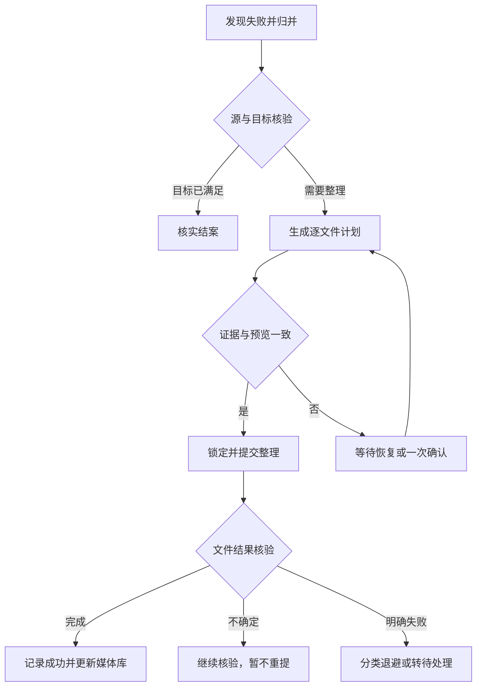

# MediaFlow「媒体整理修复」智能诊断、自动修复需求与交互方案

评审稿 · 2026-11-18 · 本地 MediaFlow v2.5.40，提交 `6bb34cc` · 当前连接 MoviePilot v2.15.6。

本文对应「MoviePilot 运维 → 媒体整理修复」，重点解决电视剧整理失败时，需要人工寻找记录、选择作品、媒体类型、季号、集号并重新整理的问题。沿用现有项目的界面和能力，补齐失败发现、参数推导、逐文件预览、自动执行、结果核验与经验复用。电影共享诊断框架，使用独立的电影身份与版本规则。

本文是待开发的需求方案。实际调查只读取了项目代码、MoviePilot 整理队列与失败历史，并核对上游同版本源码；没有执行整理、覆盖、删除历史或移动媒体文件。下文的周期、额度和交互均为建议默认值，并非已启用配置。

**范围调整（2026-11-18）：首版默认只处理模块启用后新发生的整理失败，启用前的失败历史暂不治理。** 旧记录保留在 MP，不导入默认待处理列表、不自动重试、不计入待修复数。下文 670 条历史仅用于分析错误类型，不是待执行任务清单。

## 1. 用户最终得到什么

开启自动修复后，系统持续发现 MoviePilot 新发生的整理失败。源文件仍存在、可读取且能够明确识别的项目，自动填好作品、类型、季号、集号与目标目录，调用 MoviePilot 整理并验证。新失败中已经存在合格目标的重复失败自动结案；临时故障等待恢复后有限重试；真正需要判断的，只提出具体问题，并支持将同一批文件的决定一起应用。启用前的积压历史不要求用户逐条处理。

例如，同一发布包的第 11、12 集已经下载完毕，但 MP 未识别出季集。系统从下载关联、文件名和已确认的季映射确定作品，生成两个独立文件的 S01E11、S01E12 计划；预览一致后自动整理。以后相同发布模板再出现失败，可复用经过验证的规则。

“智能”的核心是有依据地补全参数、减少重复决策，并验证文件真正落地。不能把“接口接受请求”当成“修复成功”，也不能把“失败列表变短”当成效果指标。

## 2. 当前实现与真实积压

### 2.1 当前入口存在，但尚不能完成上述闭环

| 当前实现 | 已核对行为 | 需要改进 |
|---|---|---|
| 前端 `loadTransferQueue()` | 只读取当前转移队列；非空项统一显示“卡滞”；队列空时显示畅通 | 分开显示运行中队列、历史失败、待核验结果；没有证据不能诊断锁冲突 |
| `/api/moviepilot/transfer-repair/{item_id}` | 在队列中按平面 `id/item_id` 查找，提取路径后提交 | 上游队列是作品/季及嵌套 `tasks`；失败历史应有独立的修复对象 |
| `MoviePilotClient.manual_transfer()` | 发送 `in_path`、`target`、`preview` | 与当前上游 `ManualTransferItem` 的 `fileitem/logid`、`target_path` 等契约不匹配，需要适配 |
| 修复响应 | 未提供 `success` 时默认视为成功 | 未知结构、仅受理、预览失败、实际成功必须分别处理 |
| 历史读取 | 已有整理历史读取能力；页面总数使用返回列表长度 | 保留上游 `total`、分页覆盖范围、采集完整性，不把单页当全集 |
| 现有判断引擎 | 有身份解析、季映射、集号解析、综艺分段能力 | 可以复用证据与映射，不等于现成的整理执行器 |

源码入口：[MoviePilot API](app/api/moviepilot.py)、[MoviePilot 客户端](app/clients/moviepilot.py)、[前端](frontend/index.html)、[身份解析](app/core/identity_resolver.py)、[集号解析](app/core/episode_parser.py)、[季映射](app/models/season_mapping.py)、[分段识别](app/core/segments.py)。

### 2.2 2026-11-18 实际查询快照

当前转移队列返回空列表；通过 `GET /api/v1/history/transfer?status=false` 分页读取，取得 670 个不同历史 ID，覆盖当次接口返回的全部 670 条失败历史。它们是历史失败记录，不代表 670 个当前仍然缺失或可以立即修复的文件；尚未逐一核验源文件、目标文件与后续成功记录。

| 原始错误归类 | 记录数 | 处理方向 |
|---|---:|---|
| 媒体库存在同名文件，当前覆盖模式为不覆盖 | 481 | 核验目标身份、季集、版本与文件有效性；合格则结案，冲突则保护 |
| 未识别到文件集数 | 57 | 解析真实集号、季映射与正片/特辑属性，再预览 |
| 未识别到媒体信息 | 33 | 补全作品与类型，防止同名和跨条目误绑 |
| 源文件不存在 | 54 | 查后续成功、搬迁或源路径失效，不能直接重试 |
| copy 失败 | 41 | 检查存储、容量、访问、传输状态与部分目标 |
| 错误码：-1 | 4 | 原因未知，补充诊断；不能凭错误码选择修复动作 |
| 合计 | 670 | 先重新诊断，再计算可自动处理数量 |

类型字段为电视剧 632 条、电影 5 条、未填 33 条。错误分类与媒体类型是不同维度，不能直接相加。查询跨多页，不构成数据库事务快照，持续运行时需要重叠窗口和记录去重。

抽查“未识别到文件集数”可见：

- 《奔跑吧》文件含 `S09.收官加更.part1/part2`。这是加更与分段线索，不能把 part1、part2 当成第 1、2 集。
- 《一年一度喜剧大赛》文件含“跨年”，没有明确集号。不能为了通过整理而自动塞入正片 E01。
- 《尼尔：自动人形》文件含 `Ver1.1a - 11/12`，季集字段为空。可提取 11、12 为候选集号，但仍须核实作品、季与编号体系；版本号 `1.1a` 不能当集号。

因此优先级应为：**发现真实失败 → 消除重复失败噪声 → 自动修复明确的身份/季集识别问题 → 汇总环境和复杂映射问题**。不能默认给所有失败补 S01 后重试。

## 3. 范围与模块协同

本模块负责“下载后的文件正确进入配置的媒体目录”。连载中的有效单集也应及时整理，不要求全季齐全或完结。

| 相邻模块 | 协作方式 |
|---|---|
| 真缺集待补 | 整理源中已有相应文件时，先修复整理，抑制同集重复下载；修复失败原因持续可见 |
| 连载留源 | 整理完成后更新已收集数；不擅自改变原有留源、做种策略 |
| 齐全可归档 | 完成核验后触发该季重新检查，由归档模块决定是否可归档 |
| 异常剧集/目录合并 | 复用已确认身份映射，避免另造作品目录；文件操作共用互斥机制 |
| 剧集/电影订阅清理 | 整理失败属于处理阻塞，不能直接归因无资源；已入库结论必须经核验后共享 |
| MP 原生整理 | MP 负责实际整理、命名及关联下载上下文；MediaFlow 负责诊断、计划、调度和核验 |

本期不自动删除下载任务、不自动取消做种、不删除源视频、不批量清空 MP 历史、不修改全局覆盖策略。修复确实需要移动时，必须符合用户配置的整理方式和做种约束。既有媒体的错绑纠正、替换低质量版本或清理残留文件，属于独立的高影响计划。

## 4. 失败发现与任务归并

### 4.1 数据入口

1. 失败历史接口仍为主要数据入口，但只接纳启用基线之后的新失败事件；首次建立基线，不全量导入旧失败。每轮保留读取范围、分页状态和范围内完整性，上游总数不等于待修复数。
2. 当前队列用于判断“仍在处理”，按 `media + season + tasks[]` 正确展开，不等同于失败列表。
3. 下载器任务、下载历史、后续成功历史、存储文件状态和媒体库索引用于补充证据。
4. 可增加文件漏整理巡检，但限于已配置下载目录和已完成任务；不扫描任意磁盘根目录。此入口作为第二阶段能力。
5. MP 支持且经验证的事件可加速触发，轮询仍负责漏事件补偿；不假定当前已有可靠事件订阅。

建议每 10 分钟增量扫描一次，每天仅在启用后的范围内做有上限的漏记录校对。分页存在新增、删除导致的位移，要使用时间/ID 重叠窗口与本地去重；不能仅因为遇到已见 ID 就跳过后续未见记录。达到页数上限显示“新增失败检查未完成”，保存进度并继续扫描，不能默默跳过停机期间的新失败。

### 4.2 启用基线与历史隔离

- 首次开启时持久化 MP 实例标识、接管起点、已验证的记录游标及时间口径。先建立基线再接管，初次查询遇到的旧记录不会因为“第一次看到”就成为新失败。
- 只有验证记录 ID 的单调性和实例连续性后，才可用高水位 ID 辅助判新；时间戳需明确时区和精度，分页顺序需实际验证。基线建立失败或事件先后无法确定时，显示“接管范围待确认”，不把整库记录导入自动执行。
- 暂停、重启和升级保留原始接管起点及扫描进度；恢复后补查期间新发生的失败，不重新把全部积压当新任务。MP 重建数据库或更换实例导致 ID 重置时，重新确认基线，不能仅比较数字大小。
- 旧记录可按需查询，或作为新失败的关联证据，但不因此进入自动执行。某个旧文件在接管后产生了可证实的新失败事件，可以按新事件处理；仅再次读到旧失败不算新事件。
- 首版不要求开发全库历史治理。以后确有需要时，再增加“指定日期范围/勾选记录导入”，先检查源和目标并展示可处理项，不默认追溯所有历史。

### 4.3 新失败也要先检查源文件

源存在且可读、状态稳定，只是进入修复诊断的前提，不代表立即执行；仍须通过作品、季集、预览、冲突及保护检查。源正在下载或写入时等待完成。

文件查询超时、存储掉线、鉴权失败属于“暂时无法确认源状态”，不能判为源已删除。存储正常且确认源已不存在时，做一次有边界的关联成功/已知搬迁核查：目标已满足则核实结案；否则标记“跳过：源文件不存在，无法重新整理”，退出活跃修复队列。保留可查询记录，不持续重试、不反复提醒、不自动触发重新下载。以后发现可信新址或用户主动重新检查时，可重新评估。

### 4.4 三层对象

| 对象 | 定义与用途 |
|---|---|
| 历史记录 | MP 的一次失败或成功事件，保留原始错误与 ID |
| 文件修复项 | 同一真实源文件的当前处理状态，是重试、幂等和核验单位 |
| 作品/故障组 | 同作品同季同发布包，或同一存储故障的聚合展示单位 |

源身份至少包含 MP 实例、storage、fileid（可用时）、规范化路径与文件指纹。文件指纹按后端能力使用大小、修改时间、稳定标识或校验值；不能只用文件名，也不能用路径相同断言内容相同。路径大小写及软链接语义由对应存储适配，不统一按 Windows 规则处理。

相同源多次失败只显示一个待处理项，展开可见全部历史。后续成功必须匹配文件及本次目标身份并复核目标后，才能关闭旧失败。相同路径被新文件替换、重新失败或目标消失，应重新打开问题。

## 5. 诊断分类与动作矩阵

诊断允许多标签，例如“未识别集号 + 源仍在写入”；展示一个主阻塞原因，执行前必须解除全部阻塞。

| 类别 | 主要证据 | 默认处理 | 转人工条件 |
|---|---|---|---|
| 已有合格目标/旧失败已恢复 | 稳定作品身份、集号集合/版本一致，目标有效且符合收藏要求 | 标记“已核实入库，无需重整”，保留审计 | 只有同名文件，或版本、文件完整性有疑点 |
| 媒体身份/类型未识别 | 下载关联、可信 NFO、明确 ID、已确认规则相互一致 | 自动补全作品和电影/电视剧类型 | 同名多候选、ID 冲突、仅模糊标题 |
| 季号/集号未识别 | 文件名明确编号 + 作品季信息或已确认映射 | 逐文件填写后预览与整理 | 缺少季依据、绝对编号跨季、正片/特辑混淆 |
| 错季/错集候选 | 明确季集与现有字段冲突 | 暂停自动修复，显示冲突差异 | 需要改动已有成功归档文件 |
| 临时网络/接口故障 | 超时、限流、短期不可达，未发现语义冲突 | 退避、探测恢复、有限重试 | 持续失败或恢复后仍出现相同错误 |
| 目标目录/权限/容量故障 | 存储读写能力、配置、空间等检查结果 | 按同一根因聚合，环境恢复后重诊断 | 修改挂载、目录映射、权限或容量策略 |
| 源不存在 | 存储健康，但原 storage/fileid/path 确认不存在 | 有边界地查后续成功和已确认搬迁；有新址则重建计划 | 无有效源和目标证据时标记“已跳过：源不存在”，不要求逐项人工处理 |
| 源未完成/正在整理 | 下载状态、队列与文件变化 | 等待；不抢占原生任务 | 长时间无进展，显示诊断而非强制解锁 |
| 目标冲突/部分拷贝 | 目标同名但大小、版本或完整性不符 | 保护已有目标，生成冲突对比 | 需要替换、隔离或清理残留 |
| 正片以外内容 | 加更、花絮、预告、跨年、SP/OVA 等证据 | 进入“特辑/附加内容”分流 | 无可靠特殊集映射；确认一次规则后可复用 |
| 未知异常 | 原始错误、请求和上下文 | 保留证据，停止盲目重试 | 需补能力或修复 MP/插件 |

“已核实入库”会从待处理列表移到已解决，但不修改 MP 的原历史状态；MP 原生界面仍可能显示旧失败。页面应明确“MediaFlow 已结案，MP 历史保留”，避免用户误认为执行了历史清除。

## 6. 如何自动确定作品、类型、季与集

### 6.1 证据层次

优先采用用户已确认且作用域匹配的映射、可信媒体 ID/NFO、与该文件关联的下载元数据，再结合文件名、父目录、同发布包成功记录及可信元数据交叉核实。已存在历史字段也是证据，不能因来自 MP 就视为正确。

标题别名、简繁体、日文/韩文原名可用于检索候选；“没有豆瓣收录”“纯外文名称”不能单独降低为无效内容。电影和电视剧的同一个数字 ID 不一定代表同一作品，身份键必须包含媒体来源、媒体类型和原生 ID。

同文件名与同父目录往往来自同一发布信息，不能算两份独立证据；元数据冲突时不要用多数投票掩盖冲突。模型可以辅助理解别名或错误文本，但不能凭模型猜测生成最终季集、删除或覆盖决定。

### 6.2 自动执行门槛

必须同时满足以下条件，不采用一个不透明总分直接放行：

1. 媒体身份与类型唯一，明确 ID 和有效映射之间无冲突。
2. 每个视频都有明确的季、集号集合及分段/版本含义；电影不带季集参数。
3. 源稳定、可读，未在下载写入或被其他整理/归档任务占用。
4. 目标存储和目录匹配当前配置，在已授权范围内；不靠替换字符串推断不同机器的路径。
5. MP 预览结果与本地计划逐文件一致，目标冲突检查通过。
6. 已核实本版本执行路径及覆盖策略，不会隐式清理已有目标。
7. 当前规则允许自动执行，未被保护/暂停，操作幂等检查通过。

界面用“可自动修复 / 需一次确认 / 等待环境恢复 / 不支持自动处理”说明结果，每项展开具体依据。

### 6.3 季集与附加内容规则

| 文件情况 | 处理要求 |
|---|---|
| `S02E03` | 优先读取明确季集；核对作品与季存在，冲突时不覆盖明确证据 |
| `E03`、`第03集`、`- 03` | 集号只是候选；季号取已确认上下文，不能默认 S01 |
| 动漫绝对集号 25、26 | 仅使用已确认编号映射换算；不可机械按每季 12 集拆分 |
| `E01-E02` 合集 | 保留一个文件覆盖多个集的语义；不得拆成两份相同视频虚增完成数 |
| 多季包 | 展开为实际文件，按每个文件确定季；不可整目录统一覆盖一个季号 |
| `part1/part2`、上/下期 | 先确定属于哪一期，再保留分段关系；part 不是正片集号 |
| 加更、跨年、特辑 | 有可靠特别篇映射时按其规则整理；否则用户选择附加内容去向或保留观察 |
| 年份、分辨率、编码、版本号 | 排除 `2026/1080/2160/x265/Ver1.1a` 等干扰；裸数字不可直接套集号 |
| S00、OVA、OAD | 不自动转为 S01；使用元数据中的特殊集或单独附加内容策略 |
| 剧集组、跨条目映射 | 明确源编号体系与目标编号体系；复用有效季映射，防止 offset 应用两次 |

不使用文件排序、缺集列表的第一个缺口、最近一季或已有最大集号加一来猜集号。单个不明文件不阻塞同组已经明确且互不冲突的文件。

### 6.4 经验复用

“记住本次选择”保存：MP 实例、存储与源目录作用域、作品 ID/类型、发布模板、编号体系、季映射、分段策略、目标目录配置版本及创建依据。支持仅本次、本下载包、本目录同模板三种范围；默认仅本次，不自动泛化到全站同名作品。

规则首次批量应用前展示受影响文件。后续出现明确季号冲突、另一作品、模板变化或元数据改版，立即停止套用。规则可禁用、撤销和查看命中历史；撤销只影响后续决策，不自动倒搬已整理文件。

## 7. 智能修复执行流程

### 7.1 计划必须具体到文件

计划包含原始历史 ID、源文件身份和快照、旧识别/新识别、作品 ID、类型、季、集号集合、part、目标存储及完整目标路径、整理方式、关联字幕/音轨/NFO/封面、冲突清单、依据、预计操作与核验办法。

整包只作为交互分组。季集不同的文件分别提交；需要共享参数的同构文件也必须完成逐文件预览和去重。预览暴露出未选择文件、目录展开、两个源映射同一目标、身份或季集差异时，计划不得执行。

预览后的文件、目录配置、有效规则或目标发生变化，应使计划失效。提交前重读关键状态，不能使用数小时前的确认直接执行。

### 7.2 字幕与伴随文件

MP 单文件和文件列表路径的附加文件同步行为不同，不能简单换接口就假设字幕会一起处理。对单文件路径先清点关联字幕、音轨、NFO、图片等；同名多语言字幕保留语言标识，复用文件对应关系而不是按目录全选。

无法列举或验证 MP 将同步的附加文件时，不承诺“完整修复”，转为需检查或降级仅生成计划。视频成功、字幕失败记录为“主视频已整理，附加文件待修复”，不重新转移已成功的视频。不要用旧错误 NFO 覆盖已经验证正确的新身份。

### 7.3 结果核验

| 阶段 | 可以宣告的结论 | 核验要求 |
|---|---|---|
| 接口接受 | 已提交 | 记录操作 ID、请求指纹及提交时间；不增加修复成功数 |
| MP 处理结束 | 待核验 | 查询对应历史/任务结果，失败文本与部分成功逐文件展开 |
| 目标落地 | 整理完成 | 身份、目标目录、命名、季集/版本、有效文件大小、可访问性符合计划；能力允许时核对时长、流或校验值 |
| 伴随文件满足 | 文件组完成 | 按计划确认字幕等文件，缺失列为独立待办 |
| 媒体库识别 | 入库已确认 | Emby/Jellyfin/Plex 正确识别作品和季集；媒体库离线时单独等待 |

大小相同不是内容相同的充分条件。STRM 需要验证指向及可访问性，不能只检查小文本存在；软链接需验证目标，硬链接/复制模式允许源继续存在，移动模式核实目标落地后再判断源状态。媒体库缓存或 MP 历史不能替代实际文件检查。

建议提交后按 30 秒、2 分钟、10 分钟检查，超过时限进入“结果待确认”；大型文件可按实际进度延长。媒体库未刷新仅触发受限的目录/条目刷新或等待，不重复整理。需要更新云盘视图时调用对应已验证刷新能力，刷新失败独立呈现。

### 7.4 重试、并发与异常恢复

- 暂时性错误建议按 10 分钟、30 分钟、2 小时最多重试 3 次；参数修正形成新计划，重新校验后提交，不重复提交相同已失败参数。
- 身份歧义、源丢失、权限不足、目标冲突不进入无条件定时重试。新增证据、环境恢复或用户决定才重新打开。
- 同一文件和目标占用持久化锁；与 MediaFlow 的目录合并、归档及清理共享互斥。MP 没有跨系统事务锁时，通过队列复查、串行范围控制和不覆盖策略降低竞争；不能声称已完全消除竞态。无法保证已有目标保护的范围关闭自动执行。
- 默认每个 MP 实例并发 1 个整理任务，每轮最多提交 20 个文件；按存储/下载包独立限流，避免与 MP 常规工作争抢。
- 请求超时或连接中断后先核验，禁止立即认定失败再提交。重启后恢复 `submitted/verifying` 操作，查询结果后决定是否重试。
- 多个文件出现相同存储/认证故障时开启故障组熔断，合并通知；健康恢复后分批释放。单个坏文件不应暂停所有其他作品。
- 部分成功按文件提交结果，禁止重跑整个目录。停止任务表示停止后续提交；正在 MP 内执行的动作无法撤销时，继续跟踪直到结果明确。

## 8. MoviePilot v2.15.6 接口适配与关键限制

以下依据同版本上游源码；上线前仍须检查实际部署是否有补丁，以及相应存储后端的行为。

### 8.1 已核对接口

| MP 接口/能力 | 作用 | 实施要求 |
|---|---|---|
| `GET /api/v1/history/transfer` | 分页历史，支持 `status`，返回 `data.list` 与 `data.total` | 失败发现用 `status=false`；另查关联成功，保留错误/分页状态 |
| `GET /api/v1/transfer/queue` | 作品、季及嵌套文件任务 | 不假定有可直接调用修复的平面 item_id |
| `POST /api/v1/transfer/manual/target-path` | 根据源匹配目标配置 | 获取目标存储/路径、整理方式及目录开关，不能用 MediaFlow 主机路径直接代替 |
| `POST /api/v1/transfer/episode-format/recommend` | 提供集号格式建议 | 只作候选；本地规则与 MP 预览必须一致 |
| `POST /api/v1/transfer/manual` | 手动整理及 `preview=true` 预览 | 使用真实 FileItem 或失败 logid，传入明确的身份与季集 |
| `POST /api/v1/transfer/manual/history` | 查手动整理命中的成功历史 | 用于发现重整风险，不能替代全部失败历史分析 |
| `/api/v1/history/transfer/{history_id}/ai-redo` 等 | 上游可选 AI 重整入口 | 依赖 AI 配置且会执行动作；本方案不默认依赖、不自动调用 |

`ManualTransferItem` 支持 `fileitem`、`fileitems`、`logid`，以及 `tmdbid`、`media_source/media_id`、`type_name`、`season`、`episode_format/detail/part/offset`、`episode_group`、`target_storage/path`、`transfer_type` 等。支持多个来源 ID 不表示可随意跨来源混用。

Schema 虽声明 `logids`，已检查的 `/manual` 主执行分支实际使用 `logid → fileitems → fileitem`；不能仅凭字段存在设计批量 logids 执行。批处理由 MediaFlow 调度逐文件计划。

### 8.2 不能忽略的隐式副作用

1. 通过 `logid` 重试时，上游会启用内部强制处理。如果失败历史带有 `dest_fileitem`，某些分支会在真正转移前清理旧目标。
2. 通过 `fileitem/fileitems` 整理也不天然安全：手动路径命中失败历史时，会调用历史清理逻辑；该逻辑可能删除历史所关联的目标文件。
3. `reorganize=true` 用于重新整理并清理命中的历史/旧目标，不可当普通“再试一次”开关。
4. `from_history=true` 会从历史重新填入类型、ID、季、集等字段，可能覆盖刚纠正的参数；识别修复默认使用明确计划并关闭该开关。
5. `preview=true` 可预览整理结果，但不完全模拟真实执行时的历史清理副作用。预览通过仍需独立检查上述风险。
6. 顶层 `success=true` 也可能携带包含失败项的预览数据；必须解析每个 item、summary 和 message。

**第一阶段推荐执行通道：** 对已确认是失败记录、源为单个稳定文件、历史不带 `dest_fileitem`、不存在其他相关成功/冲突目标的项目，使用精确 `logid`，明确 `from_history=false`、`reorganize=false`，传入计划中的身份/季集参数，先预览再执行。仍须检查全局有效覆盖配置、伴随文件范围和提交前状态。这样既能纠正识别，也避免依赖先删历史解锁。

携带旧目标引用的失败记录，第一阶段只诊断：若现有目标满足则结案；否则进入冲突处理，不自动调用可能清理旧目标的分支。没有可靠无损执行路径时，后续通过经过验证的 MP 扩展或升级能力解决，不能以“自动修复”为名绕过检查。

默认不显式删除历史。若将来确需清理阻塞历史，必须形成独立计划、先保存审计，明确禁止删除源/目标；并核实调用链不会另行删除目标。不能仅看 DELETE 的两个布尔参数就推断后续整理安全。

### 8.3 版本与权限

增加能力报告：版本、历史分页/过滤、队列结构、预览字段、媒体来源、目标配置、覆盖策略、文件查询及核验能力。API 不支持、返回未知结构或权限不足时显示降级原因，不能返回空列表伪装“没有问题”。

只读检查与可写整理分别检测权限；版本升级使已确认的接口行为不再可信时，继续诊断，暂停自动执行并重新验证。界面不展示 token、密码或带鉴权参数的下载 URL；原始 FileItem 中可能包含临时链接等敏感信息，日志和导出必须脱敏，执行时重新获取有效引用。

## 9. 页面与交互

### 9.1 页面结构

保留现有侧栏入口，页面标题改为“媒体整理修复”，副标题显示“已连接 MP 版本 · 接管起点 · 最近检查时间 · 新失败检查范围 · 自动修复状态”。提示“仅处理启用后的新失败，旧历史暂不处理”，不要再以“队列正常”代替整体健康结论。

顶部按钮：`立即检查`、`自动修复设置`、`暂停自动修复`。首次启用进入简短设置页，用户一次选择范围和允许动作后，高确定性任务可持续自动执行，不逐文件弹确认框。

统计卡：接管后待处理文件、可自动修复、等待恢复、需确认、今日实际修复、今日核实结案。单独显示 MP 运行中任务数；旧历史总数仅按需查询，不显示为积压告警。源已不存在的跳过项不计入待处理和成功数，在记录页可查。

标签页：`待处理`、`执行与核验中`、`已解决`、`规则与记录`。记录页提供“已跳过”筛选，与已成功区分。筛选支持类型、根因、作品/季、存储、来源下载包、时间、自动化资格与保护状态。

### 9.2 列表与聚合

默认按作品/季/发布包分组；环境问题可切换“按故障分组”。一组显示作品与 ID、涉及集数/文件数、主要原因、拟执行动作、置信依据摘要、最近进展和下一步。

| 状态 | 示例文案 | 主要操作 |
|---|---|---|
| 可自动修复 | 已确认 S01E11–E12，预览一致，等待自动整理 | 立即执行 / 查看计划 / 保护 |
| 已有目标待核验 | 目标已存在，正在核对作品、版本与完整性 | 查看对比 |
| 需确认 | 已识别作品，无法确定“跨年”对应的特别篇 | 补充一次选择 |
| 等待环境 | 同一目标存储不可写，影响 18 个文件 | 查看根因 / 恢复后重查 |
| 结果待确认 | 请求已发送，正在核实实际落地结果 | 查看进度，不提供无条件再次提交 |
| 部分完成 | 8 个视频完成，2 个特辑待确认 | 仅处理剩余项 |

每组展开文件清单，不能以一行“整季修复成功”掩盖单文件失败。批量操作仅作用于当前明确勾选的项，跨分页全选须显示准确范围、数量与不可执行原因。

### 9.3 修复详情抽屉

按用户判断顺序展示：

1. **问题是什么：** 原错误、失败时间、当前实际状态，明确历史结论与本轮检查差异。
2. **系统准备怎么改：** 原识别 → 新识别，作品 ID、媒体类型、季、集、part、版本及目标路径。
3. **为什么这样判断：** 下载关联、文件名解析、已确认映射、元数据及 MP 预览结果。
4. **逐文件对照：** 源文件 → 目标文件、字幕等伴随文件、预计动作、冲突与跳过原因。
5. **执行与验证：** 提交、MP 处理、目标落地、伴随文件和媒体库识别分别显示。

用户无需阅读 API 字段名才能做决定。技术错误和脱敏请求可折叠查看，不混入主要操作文案。

### 9.4 “补充一次选择”弹窗

先展示当前不确定的问题，例如“同名作品有两个候选”“这批文件属于哪一季”“收官加更作为哪种附加内容保存”。已确定的信息默认填入，只要求补缺失项。

作品选择显示年份、地区、原名、媒体类型和来源 ID；季选择显示季标题/集数及编号体系。逐文件集号表可编辑、批量应用明确的编号映射；缺号或特殊文件必须单独保留，不自动按排序补齐。

底部提供 `仅本次`、`记住此下载包`、`记住此目录同模板`，展示受影响文件数。点“生成预览”后看到最终差异，再“确认并修复”。若后台自动流程已有一致的有效规则，则无需再次打断用户。

特辑可选“按已确认特别篇整理”“按已配置附加内容目录保存”“保留源并暂不处理”；后两项不冒充正片整理成功。未验证目标媒体服务器支持的附加内容约定前，不自动创建所谓通用特辑目录。

### 9.5 自动化设置

| 设置 | 建议默认值 |
|---|---|
| 工作模式 | 初次先展示诊断结果；用户开启后进入持续自动修复 |
| 历史范围 | 仅接管起点之后新发生的失败；启用前历史不导入、不重试 |
| 源文件不存在 | 确认并完成有限关联核查后跳过，保留记录，不自动重新下载 |
| 范围 | 选定 MP 实例、下载源目录和目标目录；电视剧优先 |
| 自动动作 | 高确定性身份/季集补全、临时故障恢复重试、已有合格目标核实结案 |
| 已有目标替换/重新整理 | 关闭，单独计划 |
| 整理方式 | 继承当前匹配目录配置，并核验做种/源保护约束 |
| 扫描周期 | 10 分钟，允许按实际负载调整 |
| 执行并发/每轮额度 | 1 / 20 个文件 |
| 重试预算 | 同一计划最多 3 次，超时不确定不占用盲重试通道 |
| 保护 | 作品、季、下载包或文件可暂停自动修复并注明原因 |
| 通知 | 每日汇总；新增需确认/环境故障按组提醒并去重 |

暂停全局自动修复后仍可诊断和核验已提交任务。恢复时先重新检查计划，过期计划不直接执行。

## 10. 状态、数据与内部接口建议

### 10.1 状态模型

建议使用 `discovered → diagnosing → ready → submitted → verifying → resolved` 主链，以及 `waiting_source`、`waiting_environment`、`needs_confirmation`、`conflict`、`protected`、`exhausted`、`skipped` 分支。启用前历史处于接管范围之外，不要求逐条创建本地修复项。

`resolved` 必须有明确结果码：`repaired` 实际整理成功、`already_present_verified` 已有合格目标、`superseded_by_success` 后续成功已核实、`user_disposition` 用户选择保留/忽略。不同结果分开统计；仅用户忽略不能算自动修复成功。确认源不存在且无可恢复新址的项目进入 `skipped/source_missing`，退出活跃队列，但不归入已成功。

### 10.2 持久化

沿用现有 SQLAlchemy/SQLite，在明确迁移中新增修复项、计划、操作、规则与故障组数据，不以进程内列表承担执行状态。

| 数据 | 必要信息 |
|---|---|
| 接管基线与游标 | MP 实例/连续性标识、接管起点、时间口径、扫描进度、重叠窗口和检查完整性；重启不得重置 |
| 修复项 | 实例/源身份、关联历史 IDs、首末发现、错误分类、当前状态、目标身份、保护范围 |
| 证据快照 | 来源、采集时间、完整性、可信程度、文件属性、原始错误及脱敏元数据 |
| 修复计划 | 逐文件参数与路径、附加文件、预览、冲突、配置/映射版本、失效条件、计划摘要哈希 |
| 操作日志 | 操作 ID、幂等键、锁租约、提交与确认时间、MP 响应、尝试次数、文件核验结果 |
| 规则 | 作用域、作品与编号体系、模板、创建人、证据、版本、启停、命中及失败记录 |
| 故障组 | 存储/实例/错误签名、影响范围、恢复检查、熔断与通知状态 |

幂等键包含源文件版本、目标身份/映射和计划版本；历史 ID 或标题均不足以作为唯一操作键。原错误与计划证据必须先落盘，再提交可能产生副作用的请求。审计至少保留 90 天，可配置；长期规则需保留其确认依据。

### 10.3 MediaFlow 新接口建议

以下为待开发的 MediaFlow 内部接口，不是现有 MP API：

| 接口建议 | 行为 |
|---|---|
| `POST /api/moviepilot/transfer-repair/scan` | 启动诊断任务，返回任务 ID，不整理 |
| `GET /api/moviepilot/transfer-repair/items` | 分页列表、聚合统计、数据覆盖范围 |
| `GET /api/moviepilot/transfer-repair/items/{id}` | 证据、文件计划、历史与核验结果 |
| `POST /api/moviepilot/transfer-repair/items/{id}/plan` | 更新用户选择并生成新预览，返回计划版本 |
| `POST /api/moviepilot/transfer-repair/execute` | 提交明确计划 IDs/版本和幂等键，逐项说明接收/跳过原因 |
| `POST /api/moviepilot/transfer-repair/items/{id}/protect` | 保护或解除保护，记录作用域 |
| `POST /api/moviepilot/transfer-repair/items/{id}/recheck` | 重诊断，不等同重新整理 |
| `GET/PUT /api/moviepilot/transfer-repair/settings` | 自动范围、动作、额度、通知与暂停 |
| `GET/POST/PATCH /api/moviepilot/transfer-repair/rules` | 规则查阅、创建与启停 |

旧 `/transfer-repair/{item_id}` 应废弃或只转换为诊断入口，不能继续凭任意字符串直接执行。新增静态路由与动态路由要避免匹配冲突。服务端重新校验权限、范围和计划版本，前端禁用按钮不能替代后端验证。

## 11. 验收场景

| 编号 | 场景 | 必须达到的结果 |
|---|---|---|
| R01 | 队列空，接管后仍有新失败 | 显示范围内待诊断；若仅有接管前旧失败，提示“当前接管范围无待处理”，不报整库全部正常 |
| R02 | 多页失败记录并有实时新增 | 去重、标记覆盖范围，不把第一页计数当全部 |
| R03 | 标准 S02E03，MP 身份识别失败 | 有唯一可信身份且无冲突时自动预览、整理并核验 |
| R04 | 只有 E03，季无法确定 | 不默认 S01，集中提出一次季选择 |
| R05 | 同名电影与电视剧 | 以类型+来源+ID 区分，不交叉写入目录 |
| R06 | 动漫 `Ver1.1a - 11` | 排除版本号，季映射不明确前不自动执行 |
| R07 | 绝对集号跨季 | 使用明确映射，offset 只应用一次 |
| R08 | 多季包夹带特辑 | 明确正片可分别完成，特辑单列，不整包套同一季 |
| R09 | E01-E02 合并视频 | 记录一个文件覆盖两集，不复制成两份 |
| R10 | 加更 part1/part2 | 不变成 E01/E02；保持分段与附加内容语义 |
| R11 | 同名目标确为合格视频 | 核验结案，不重整，不删除源或 MP 历史 |
| R12 | 同名目标是不同版本/错误作品/残缺视频 | 进入冲突，禁止自动覆盖 |
| R13 | 失败历史带 dest_fileitem | 识别上游隐式清理风险，不走普通自动重试 |
| R14 | 失败源已搬走，后续成功可验证 | 关联成功后结案，不标源丢失或触发重下载 |
| R15 | 存储健康，确认源不存在且无成功/新址证据 | 记录“已跳过：源不存在”，退出活跃队列，不重试、不声称成功、不自动重下载 |
| R16 | 复制整理成功且仍做种 | 源保留正常，不重复整理、不删除下载任务 |
| R17 | 预览顶层成功但个别 item 失败 | 失败文件不得执行，准确报告部分可执行范围 |
| R18 | 预览后目标出现或源变化 | 旧计划失效，重新判断，不继续用旧确认 |
| R19 | 请求超时、服务重启 | 从持久化操作恢复核验，不重复提交 |
| R20 | 视频成功字幕失败 | 保留视频成功结果，只修复附加文件 |
| R21 | MP 返回成功但目标不可核验 | 留在待核验，不增加实际修复成功数 |
| R22 | 媒体库离线但目标已有效落地 | 单列等待媒体库确认，不重新复制视频 |
| R23 | 同一存储故障影响多文件 | 一组通知与熔断，恢复后限流处理 |
| R24 | 自动规则命中另一作品或新季冲突 | 停止套规则，说明冲突并允许修订作用域 |
| R25 | MP 升级或接口响应结构改变 | 降级只读诊断，报告能力变化，不显示空成功 |
| R26 | 用户暂停或保护一季 | 停止新提交，已提交的继续跟踪到结果明确 |
| R27 | 归档/目录合并正在操作同一文件 | 互斥或等待，不同时移动或清理 |
| R28 | 电影包含导演剪辑版、普通版 | 版本单独识别，无季集参数，不因同 ID 覆盖另一版本 |
| R29 | 首次启用时已有 670 条旧失败 | 建立接管基线，旧记录不进默认待处理、不执行、不删除 |
| R30 | 暂停/停机期间发生新失败 | 沿原接管基线和游标补查，不漏新失败、不导入全部旧历史 |
| R31 | 存储离线导致源查询失败 | 等待环境恢复，不能按“源不存在”跳过 |
| R32 | MP 实例更换或历史 ID 重置 | 发现游标连续性异常，重新确认接管范围，不盲目跳过或全库接管 |
| R33 | 旧文件在启用后再次产生新失败 | 有新事件证据才进入当前诊断；再次读取旧记录不能触发重试 |

除离线规则与接口契约测试外，集成验证需覆盖测试目录中的复制、移动、硬/软链接及实际启用的云盘后端；尤其验证历史隐式删除、附加文件展开与预览/执行差异。不得用生产库随机失败记录作为首次破坏性测试样本。

## 12. 分阶段落地与衡量

### 第一阶段：直接覆盖当前主要需求

修正接口契约和队列展示；建立接管基线，只采集启用后新失败并归并；优先检查源文件，核验已有目标；完成单文件、唯一身份、明确季集、无旧目标引用的自动修复；提供一次确认、逐文件预览、有限重试、持久化操作与结果核验。旧历史治理不纳入首版必做范围。

自动修复首版就必须可闭环运行，不只做一个“待人工点击”的失败列表。此前抽查的 481 条同名目标、57 条缺集号、33 条身份失败仅帮助确定需要覆盖的错误类型，不进入首版自动处理清单。先稳定处理今后的可恢复失败，避免积累新的人工工作量。

### 第二阶段：降低长期维护成本

加入经过作用域约束的经验规则、同包批量决策、动漫绝对编号/剧集组、综艺附加内容分流、环境故障自动恢复和漏整理巡检；与真缺集、订阅清理共享结果，减少重复下载与误退订。

### 第三阶段：有条件处理高影响问题

在具备可靠备份/隔离、目标防护和经验证执行能力后，再做旧目标冲突、错绑文件纠正、残留清理等独立计划。回退必须明确可恢复内容和限制；移动、覆盖和外部删除不承诺通用一键撤销。

衡量指标分别统计：接管后新失败检查覆盖率、活跃文件问题数、实际整理成功数、核实已有目标结案数、自动处理率、一次确认解决的文件数、重复失败率、错误映射/覆盖事故数，以及各根因的积压时间。旧历史不计入积压与处理率分母；源不存在等跳过项单列数量和原因，不算成功。自动处理率分母采用范围内已完成诊断且具备核验条件的活跃问题，并同时披露因能力不足被排除的数量。

## 13. 资料与适用边界

本地方案关联：[剧集订阅清理](MediaFlow剧集订阅智能清理需求与交互方案-v2.5.39.md)、[电影订阅清理](MediaFlow电影订阅智能清理需求与交互方案-v2.5.40.md)、[异常剧集](MediaFlow异常剧集模块需求与交互方案-v2.5.56.md)、[缺集待补](MediaFlow缺集待补模块需求与交互方案-v2.5.56.md)、[综艺分段识别](MediaFlow综艺分段识别与订阅清理改进方案-2026-11-10.md)。

上游依据均为 MoviePilot 官方仓库 `v2.15.6` 对应源码，读取日期 2026-11-18：

- [整理 API](https://github.com/jxxghp/MoviePilot/blob/v2.15.6/app/api/endpoints/transfer.py)：队列、手动整理、预览、目标匹配、历史参数及附加文件调用差异。
- [整理请求与任务 Schema](https://github.com/jxxghp/MoviePilot/blob/v2.15.6/app/schemas/transfer.py)：FileItem 输入、季集字段、嵌套队列和重新整理标志。
- [历史 API](https://github.com/jxxghp/MoviePilot/blob/v2.15.6/app/api/endpoints/history.py)：分页、状态过滤、总数、历史删除与 AI 重整入口。
- [整理链路](https://github.com/jxxghp/MoviePilot/blob/v2.15.6/app/chain/transfer.py)：`manual_transfer`、`do_transfer`、历史清理及旧目标删除语义。

本次已完成接口读取与源码分析，没有逐文件检查全部 670 条记录的实体目标，也没有在实际存储上测试修复执行。因此数据表反映当次历史积压与错误分布，自动化可行数量、附加文件效果和各存储原子性需要实施时验证。
