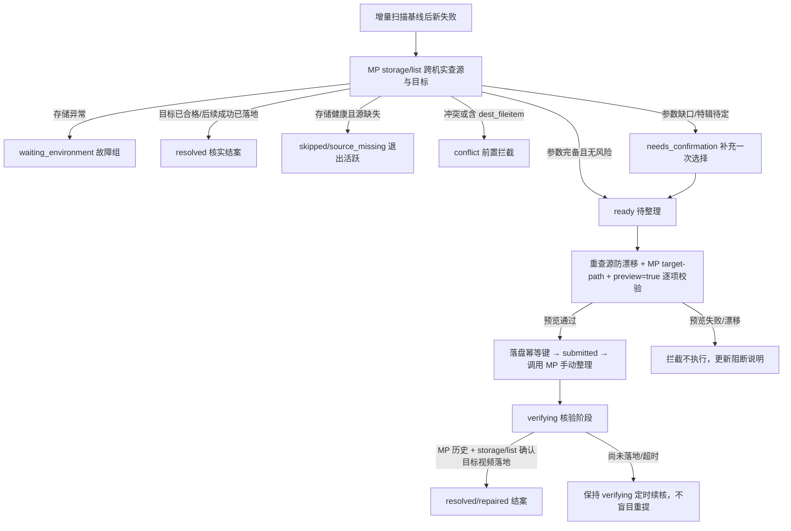

# MediaFlow「媒体整理修复」智能诊断、自动修复需求与交互方案

现行落地稿 · 2026-11-28 · MediaFlow **`v2.5.83`**（核心闭环落地于 `v2.5.66`，沿用并升级自 `v2.5.40` 评审稿）· 当前连接 MoviePilot `v2.15.6`。

本文对应「MoviePilot 运维 → 媒体整理修复」，重点解决电视剧整理失败时，需要人工寻找记录、选择作品、媒体类型、季号、集号并重新整理的问题；同时覆盖跨机部署（Windows 宿主机 + Linux/Docker NAS）下的真实存储核查、目标落地核验与经验复用闭环。电影共享诊断框架，使用独立的电影身份与版本规则。

**阅读说明：第 0 节为 `v2.5.66 ~ v2.5.83` 现行最高优先级生效规范与生产验证结论；第 1 ~ 13 节已按现行实现与上游实测契约完成全面核对修订，同时明确标注第一阶段已落地边界与第二/三阶段演进范围。**

**范围约定：默认仅处理模块启用基线之后新发生的整理失败，启用前的存量失败历史暂不治理。** 旧记录保留在 MoviePilot，不导入默认待处理列表、不自动重试、不计入待修复数。下文 2026-11-18 的 670 条历史快照仅作为错误类型分析样本，不是待执行任务清单。

---

## 0. v2.5.66 ~ v2.5.83 落地实现、生产验证与现行生效规范（最高优先级）

### 0.1 演进脉络与关键故障根治

本模块历经三阶段演进：
1. **`v2.5.40`（2026-11-18）**：基于 MoviePilot `v2.15.6` 上游源码与 670 条真实失败历史完成评审方案定稿。
2. **`v2.5.43`（2026-11-18）**：建立初版数据表、推导规则与基础前端视图，但在真实跨机生产环境中暴露 4 类阻断性缺陷：`settings` 接口漏传 `mp_client` 导致 `baseline_history_id = 0` 静默固化并反复拉满 250 条旧历史；在 Windows 宿主机对 NAS Linux 路径 `/video/downloads/...` 调用 `os.path.exists()` 导致 100% 误判 `source_missing` 跳过；漏读 MP 真实报错字段 `errmsg` 导致 100% 空报错与 `unknown` 分类；执行链路缺失 `preview=true` 校验与目标落地核验（收到 HTTP 响应即宣告成功）。
3. **`v2.5.66` 生产级五层闭环重构（2026-11-22，沿用稳定运行至当前 `v2.5.83`）**：一次性根治上述全部缺陷，完成跨机 `POST /api/v1/storage/list` 实查、安全基线门禁、`ManualTransferItem` 契约适配、预览+落地核验状态机、后台定时调度循环与分组聚合前端交互。

### 0.2 真实生产环境运行验证（2026-11-22 ~ 2026-11-28）

- **基线锚定（方案 A）**：2026-11-22 清理此前因 `0` 基线误导入的 266 条历史脏数据，将接管基线精确锚定至 MoviePilot 最新失败 ID **`#105749`**（`2026-11-21 16:25:13`），`baseline_status = "active"`。
- **连续 6 天实盘运行数据**：后台调度循环持续稳定运转至 `2026-11-28`，扫描游标推进至 **`#106391`**，零基线漂移、零旧历史回灌。
- **新失败真实闭环记录（8 条）**：期间捕获 8 条新失败事件——《王子与乞丐》S01E01/E02/E03/E05（`#106321–106325`，4.22 GB – 5.12 GB）与《爱之乡》S03E09–E12（`#106388–106391`，1.24 GB – 1.52 GB），MP 原始 `errmsg` 均为 `媒体库存在同名文件，当前覆盖模式为不覆盖`。系统自动保留 MP 中文剧名、通过 `POST /api/v1/storage/list` 跨机核实源与目标文件真实存在且体积一致，全部自动标记为 **`resolved / already_present_verified`** 结案，**0 误判 `source_missing`、0 空报错**。

### 0.3 现行已落地能力 vs 后续阶段边界清单

| 能力域 | 现行状态（v2.5.83） | 说明与源码锚点 |
| :--- | :---: | :--- |
| 接管基线持久化、防 0 固化、实例/ID 回退熔断与受控重设 | **已落地** | `TransferRepairBaseline`（`active`/`pending_confirm`/`reset_required`）、`POST /baseline/reset` |
| 跨机远程存储核查（MP `storage/list` 目录级缓存 + 父级探活） | **已落地** | `MoviePilotClient.list_storage_dir`、`_StorageProbeCache`（彻底废除宿主机 `os.path.exists`） |
| MP 真实字段对齐（`errmsg`、中文原标题保留、敏感字段脱敏） | **已落地** | `extract_raw_error`、`sanitize_fileitem`（剥离 `url`/`pickcode`/`token`/`cookie`） |
| 同名合格目标自动结案 + 有界后续成功查重 + `dest_fileitem` 拦截 | **已落地** | `is_qualified_target_video`（`>10MB` 且 `≥50%` 源体积）、`find_subsequent_success` |
| 季集智能推导、版本噪音过滤、电影隔离、连集/分段/特辑保护 | **已落地** | `app/core/transfer_repair.py`（覆盖 R03–R10） |
| MP v2.15.6 `ManualTransferItem` 契约、强制 `preview=true` 与漂移拦截 | **已落地** | `build_mp_manual_transfer_payload`、`parse_mp_preview_response`（R16–R18） |
| `submitted → verifying → 目标落地核验 → resolved` 与伴随字幕清点 | **已落地** | `execute_repair_plans`、`verify_repair_item`、`find_companion_subtitles`（R19–R21） |
| 后台 60s 心跳调度器（在途核验恢复、定时扫描、退避重试、自动修复） | **已落地** | `run_transfer_repair_tick`、`transfer_repair_scheduler_loop`（挂载于 `app/main.py`） |
| 14 个 REST 接口 + 前端分组聚合、5 段式真实详情抽屉与两步补充选择 | **已落地** | `app/api/moviepilot.py`、`frontend/index.html`、`tests/test_transfer_repair.py`（14/14 PASS） |
| 媒体服务器（Emby/Jellyfin）入库识别自动终验 | **二阶段待补** | 核验状态已预留 `mediaserver_confirmed` 槽位，当前以 MP 历史 + 存储目标落地为终验依据 |
| 下载目录漏整理主动巡检 | **二阶段待补** | 当前以 MP `history/transfer?status=false` 为发现主入口 |
| 伴随字幕缺失独立补传与多进程持久化锁 | **二阶段待补** | 当前已做字幕清点与缺失独立告警（不重跑视频），互斥锁为单进程 `_ACTIVE_REPAIR_PATHS` |
| 规则命中计数回写、按日期范围手动导入旧历史、分组通知推送 | **二阶段待补** | 规则匹配与创建已落地；旧历史按需导入与通知通道待二期扩展 |
| 旧目标冲突替换、错绑文件纠正与残留清理高影响计划 | **三阶段规划** | 当前严格拦截进入 `conflict`，绝不自动覆盖或清理旧目标 |

---

## 1. 用户最终得到什么

开启自动修复后，系统持续发现 MoviePilot 新发生的整理失败。源文件仍存在、可读取且能够明确识别的项目，自动填好作品、类型、季号、集号与目标目录，先调用 MoviePilot 预览核对一致，再提交整理并核验目标真实落地。新失败中已经存在合格目标的重复失败自动结案；临时故障等待恢复后有限退避重试；真正需要判断的，只提出具体问题，并支持将同一下载包/目录模板的决定复用沉淀。启用前的积压历史不要求用户逐条处理。

例如，同一发布包的第 11、12 集已经下载完毕，但 MP 未识别出季集。系统从下载关联、文件名和已确认的季映射确定作品，生成两个独立文件的 S01E11、S01E12 计划；预览一致后自动整理并核验落地。以后相同发布模板再出现失败，可复用经过验证的规则。

“智能”的核心是有依据地补全参数、减少重复决策，并验证文件真正落地。绝不把“接口接受请求”当成“修复成功”，也不把“失败列表变短”当成效果指标。

---

## 2. 历史基线问题与现行实现对照

### 2.1 从 v2.5.40 基线缺陷到 v2.5.83 现行实现

| 关注点 | v2.5.40 改造前现状 | v2.5.83 现行已落地状态 |
| :--- | :--- | :--- |
| 前端 `loadTransferQueue()` | 只读当前转移队列；非空统一报“卡滞”，队列空即报“畅通” | 已升级为 `loadTransferRepairData()`，分开展示 MP 运行中展开任务数、接管后待处理/核验中/已解决/规则与跳过记录，绝不以队列空代替整体健康 |
| `/api/moviepilot/transfer-repair/{item_id}` | 在平面队列查找 `id/item_id` 直接提交 | 已升级为 14 个独立修复对象端点；队列按 `media + season + tasks[]` 正确展开（`flatten_transfer_queue`），旧端点保留兼容路由 |
| `MoviePilotClient` 契约 | 发 `in_path`/`target`，漏传 `fileitem`，漏读 `errmsg` | 已全面对齐 MP `v2.15.6`：`POST /api/v1/storage/list`、`POST /api/v1/transfer/manual/target-path`（`{"fileitem": ...}`）、`ManualTransferItem` 与 `errmsg` 提取 |
| 跨机源文件核查 | 无跨机检查（v2.5.43 曾误用宿主机 `os.path.exists` 致 100% 误跳过） | 统一走 MP `POST /api/v1/storage/list` 目录级缓存实查，彻底兼容 Windows 宿主机 + Linux/Docker NAS/115/SMB 架构 |
| 修复结果判定 | 缺 `success` 默认当成功，接口返回即标完成 | 强制先 `preview=true` 逐项核验，提交后经 `submitted → verifying → 目标落地核验 → resolved/repaired` 闭环 |
| 历史读取与基线 | 单页长度当总数，无接管基线 | 保留上游 `total`、分页截断标记 `truncated` 与持久化安全基线（禁止 `0` 基线静默落盘） |
| 后台自动化调度 | 无后台任务 | `app/main.py` 生命周期挂载 `transfer_repair_scheduler_loop`（60s 心跳，按 `scan_interval_minutes` 与 `auto_repair_enabled` 运转） |

核心源码入口：[数据模型](app/models/transfer_repair.py)、[核心诊断与契约引擎](app/core/transfer_repair.py)、[调度与核验服务](app/services/transfer_repair_service.py)、[MoviePilot API 路由](app/api/moviepilot.py)、[MoviePilot 客户端](app/clients/moviepilot.py)、[应用生命周期](app/main.py)、[前端界面](frontend/index.html)、[专项测试套件](tests/test_transfer_repair.py)、[身份解析](app/core/identity_resolver.py)、[集号解析](app/core/episode_parser.py)、[季映射](app/models/season_mapping.py)、[分段识别](app/core/segments.py)。

### 2.2 2026-11-18 历史积压分析样本（670 条，仅作错误类型建模参考）

该次调查通过 `GET /api/v1/history/transfer?status=false` 分页读取 670 条不同历史 ID（电视剧 632 条、电影 5 条、未填 33 条），用于确立本模块需要覆盖的 6 类真实故障模式（不进入默认待处理清单）：

| 原始错误归类（`errmsg`） | 样本数 | 现行处理方向 |
| :--- | ---: | :--- |
| 媒体库存在同名文件，当前覆盖模式为不覆盖 | 481 | 通过 MP `storage/list` 核验目标文件真实存在与体积比例；合格则 `already_present_verified` 自动结案，残缺或冲突则 `conflict` 保护 |
| 未识别到文件集数 | 57 | 剔除版本号/编码噪音，解析真实集号、季映射与正片/特辑属性；缺季号转 `needs_confirmation`，绝不默认 S01 |
| 未识别到媒体信息 | 33 | 结合文件名、父目录与用户补充选择确定作品与类型，防同名和跨条目误绑 |
| 源文件不存在 | 54 | 经 MP `storage/list` 确认存储健康且源确实不在后，查有界后续成功历史（R14）；无证据则标 `skipped/source_missing` |
| copy 失败 | 41 | 核查存储连通性、目标残缺与后续成功；环境故障归入 `waiting_environment` 故障组并退避重试 |
| 错误码：-1 / 其他未知 | 4 | 保留 `errmsg` 与上下文证据，停止盲目重试 |
| 合计 | 670 | 先实查核验、消噪结案，再自动修复高确定性识别问题 |

典型难例解析规则（均已覆盖于 `tests/test_transfer_repair.py`）：
- 《奔跑吧》含 `S09.收官加更.part1/part2`：识别为 `season=9, part="part1", is_special=True, special_type="加更"`，绝不把 `part1/part2` 当成 E01/E02。
- 《一年一度喜剧大赛》含“跨年”且无明确集号：归入特辑待确认，绝不自动塞入正片 E01。
- 《尼尔：自动人形》含 `Ver1.1a - 11/12`：正则 `_VERSION_TAG_REGEX` 优先剔除 `Ver1.1a` 干扰，提取 `[11]` / `[12]`，季号未明前不自动执行。

---

## 3. 范围与模块协同

本模块负责“下载后的文件正确进入配置的媒体目录”。连载中的有效单集也应及时整理，不要求全季齐全或完结。

| 相邻模块 | 协作方式 |
| :--- | :--- |
| 缺集待补 | 整理源中已有相应文件时，先修复整理，抑制同集重复下载；修复失败原因持续可见 |
| 连载留源 | 整理完成后更新已收集数；不擅自改变原有留源、做种策略 |
| 齐全可归档 | 完成核验后由归档模块按最新实盘状态决定是否可归档 |
| 待复核清理 / 异常剧集 / 目录合并 | 复用已确认身份映射，避免另造作品目录；通过 `is_repair_path_locked` 共享路径互斥保护 |
| 剧集 / 电影订阅清理 | 整理失败属于处理阻塞，不能直接归因无资源；已入库结论须以实盘核验为准 |
| MP 原生整理 | MP 负责实际整理、命名及存储操作；MediaFlow 负责基线发现、跨机核验、计划预览、调度与落地确认 |

**安全红线（严禁触碰）**：不自动删除下载任务、不自动取消做种、不删除源视频、不批量清空 MP 历史、不修改 MP 全局覆盖策略。既有媒体的错绑纠正、替换低质量版本或清理残留文件，保留为三阶段独立高影响计划。

---

## 4. 失败发现、接管基线与任务归并

### 4.1 数据入口与扫描策略

1. **失败历史主入口**：调用 `GET /api/v1/history/transfer?status=false`，仅接纳 `id > baseline_history_id` 的新失败事件；保留分页覆盖范围、扫描页数与 `truncated` 截断状态（触达页数上限时顶栏告警提示“新增失败检查未完成”）。
2. **运行中队列展开**：调用 `GET /api/v1/transfer/queue` 并经 `flatten_transfer_queue` 展开 `media + season + tasks[]`，仅用于展示 MP 当前运行中任务数，不等同于失败列表。
3. **跨机存储与后续成功证据**：调用 `POST /api/v1/storage/list` 实查源与目标文件（单轮扫描内按 `(storage, parent_dir)` 缓存，同发布包多文件仅发 1 次请求），并有界查询 `GET /api/v1/history/transfer?status=true&title=...` 核实后续成功记录。
4. **后台调度**：`app/main.py` 挂载后台异步循环（每 60 秒心跳检查），按 `scan_interval_minutes`（默认 10 分钟）执行增量扫描，并在每次心跳恢复核验 `submitted/verifying` 项。
5. **下载目录漏整理主动巡检**与**MP 事件加速订阅**：作为第二阶段扩展能力保留。

### 4.2 启用基线与历史隔离（防 0 基线铁律）

- **严格基线锚定**：首次启用必须携带有效 `mp_client` 实时读取 MP 最新失败历史高水位（`baseline_history_id`、`baseline_date`）及实例地址指纹（`mp_origin`）、版本号（`mp_version`），成功后方置 `baseline_status = "active"`。
- **禁止 `0` 基线静默落盘**：若初始化时未传 `mp_client` 或 MP 不可达，保持 `baseline_status = "pending_confirm"`；若检测到历史遗留的 `baseline_history_id == 0` 且已扫过记录，自动转 `reset_required`。非 `active` 状态下扫描直接拦截并返回提示，绝不将整库旧历史导入待处理列表。
- **实例连续性校验（R32）**：当 `mp_origin` 变更或扫描第 1 页最大历史 ID 小于已记录 `baseline_history_id`（MP 换实例或重建库）时，立即置 `baseline_status = "reset_required"` 并暂停自动接管，由用户通过「重设基线」明确重新锚定。
- **重启与升级保留**：暂停、重启和服务升级严格保留原始接管起点与已落盘记录；恢复后继续按原基线补查期间新增失败。

### 4.3 跨机源文件存在性核查（绝不使用宿主机本地路径探测）

- **硬性架构规则**：MediaFlow（Windows）与 MoviePilot（Linux/NAS/Docker/云盘）通常位于不同主机或挂载命名空间。**严禁在服务层对 MP 源/目标路径调用 `os.path.exists()`**，必须统一通过 `MoviePilotClient.list_storage_dir(storage, parent_dir)` 经由 MP 原生 `POST /api/v1/storage/list` 实时核查。
- **存储故障 vs 源缺失严格区分（R15 / R31）**：
  - `storage/list` 超时、网络异常、鉴权失败或返回 `success=false` → `storage_healthy = False` → 进入 `waiting_environment`，**绝不按“源不存在”跳过**；
  - 父目录正常返回空列表时，再向上探查一级父目录确认存储本身可达；确认存储健康且源文件不在后，先做一次有界后续成功历史查重（R14），若目标已满足则 `superseded_by_success` 结案，否则标为 `skipped / source_missing` 退出活跃队列，不自动重试、不触发重下。

### 4.4 三层对象抽象

| 对象 | 定义与实现承载 |
| :--- | :--- |
| 历史记录 | MP 一次失败或成功事件（保留 `latest_history_id` 与完整 `mp_history_ids_json` 关联数组） |
| 文件修复项 | `TransferRepairItem`：以规范化 `source_path` 归并的真实源文件实体，是诊断、重试、幂等和核验的原子单位 |
| 作品 / 故障组 | 通过 `failure_group_key` 聚合：正常问题按 `work:{media_type}:{tmdb_id/title}:{season}:{package}` 分组，环境故障按 `env:{storage}:{error_sig}` 分组 |

同一源文件多次失败只展示一个修复项并累加关联历史 ID；非终态/非保护项在重扫或调用 `/recheck` 时按最新存储和规则重新诊断刷新状态，避免状态永久卡死。

---

## 5. 诊断分类与动作矩阵

诊断按短路优先级决定主状态并记录完整 `evidence_json`，执行前必须满足全部安全门禁：

| 类别 / 状态 | 主要证据 | 现行默认处理 | 转人工 / 拦截条件 |
| :--- | :--- | :--- | :--- |
| 存储 / 环境故障 (`waiting_environment`) | `storage/list` 超时/失败、网络/鉴权异常 | 按 `env:{storage}:{error_sig}` 归入故障组，等待恢复后重查或退避重试 | 持续失败超过重试预算转 `exhausted` |
| 后续成功已核实 (`resolved / superseded_by_success`) | 查得 `id > 失败ID` 的同源或同 `(tmdbid,S,E)` 成功记录且目标经 `storage/list` 核实有效 | 自动结案，保留 MP 原历史 | 目标文件不可查或体积异常 |
| 已有合格目标 (`resolved / already_present_verified`) | 目标经 `storage/list` 确认存在、`size > 10MB` 且在有源体积时不低于源的 `50%`、无身份冲突 | 自动结案，不重整、不删源与历史 | 目标过小（`≤10MB`）、不足源 `50%` 或身份版本存疑 |
| 源文件不存在 (`skipped / source_missing`) | 存储健康（含上级探活确认），源确认不在且无合格目标/后续成功 | 退出活跃待处理队列，归入「规则与记录」审计，支持手动「重查」 | 仅当用户重新核查或新址出现时重评 |
| 目标冲突 / 旧目标风险 (`conflict`) | `errmsg` 命中同名冲突但目标核验未通过，或历史携带 `dest_fileitem` 且目标未证实合格 | 前置拦截，禁止自动覆盖与带隐式删目标风险的 `logid` 重试 | 展示源/目标大小与风险提示，由人工处理 |
| 媒体身份 / 季集 / 特辑待定 (`needs_confirmation`) | 缺标题、仅有 `E03` 无季依据、仅特辑/分段无正片集号 | 保留原识别与已解析字段，提出具体缺口供「补充一次选择」 | 用户确认并可选沉淀规则后转 `ready` |
| 可自动修复 (`ready`) | 身份、类型、季集明确（电影无季集）、源稳定存在、无 `dest_fileitem` 风险 | 观察模式等待一键/批量执行；开启自动修复后后台按额度预览并执行 | 预览失败或源体积漂移则中止 |
| 已保护 (`protected`) | 用户手动加盾保护 | 跳过扫描覆盖与自动执行 | 随时可解除保护 |

“已核实结案”仅更新 MediaFlow 本地状态，不修改或删除 MP 原历史记录；文案明确标注“MediaFlow 已核实结案（保留 MP 原历史与源文件）”。

---

## 6. 参数推导、执行门槛与经验复用

### 6.1 证据层次与原识别保留

- **保留 MP 原识别**：单独持久化 `mp_title`、`mp_seasons`、`mp_episodes`、`mp_mode`、`mp_date`、`tmdbid`；当 MP 已给出有效中文剧名（如《垂涎》《爱之乡》）且原错误并非 `no_media_info` 时，优先保留 MP 中文剧名，不被英文文件名（如 `ABO.Desire`）覆盖。
- **脱敏要求**：`src_fileitem` 与 `dest_fileitem` 落盘前强制经 `sanitize_fileitem` 剔除 `url`、`download_url`、`pickcode`、`token`、`cookie`、`auth` 等敏感字段，执行时通过 `storage/list` 实时刷新最新 `FileItem`。
- **电影与电视剧命名空间隔离（R05）**：识别为电影（MP 类型为电影或路径命中 `/电影/`、`/movies/`）时，强行清空 `season_number`、`episode_numbers`、`part`、`is_special`，绝不向 MP 传季集参数。

### 6.2 自动执行门槛（全部满足才进入 `ready`）

1. 媒体身份与类型唯一，规则与已有 `tmdbid` 无冲突；
2. 电视剧同时具备明确季号与有效集号（或已确认特别篇规则）；电影不带季集；
3. 通过 MP `storage/list` 实查源稳定存在且提交前体积未发生漂移（R18）；
4. 无 `dest_fileitem` 隐式清理风险、无目标冲突；
5. 提交前调用 MP `preview=true` 通过顶层及逐项 `items` 一致性校验（R17）；
6. 未被保护、未与其他任务路径锁冲突、未超重试预算。

### 6.3 季集与附加内容规则

| 文件情况 | 现行实现要求 |
| :--- | :--- |
| `S02E03` | 优先匹配标准 `SxxExx`，直接提取季与集（R03） |
| `E03`、`第03集`、`- 03` | 结合父目录 `Season X / S02 / 第X季`、已确认规则或 MP 已识别季号；若全无季依据绝不默认 `S01`，转 `needs_confirmation`（R04） |
| 动漫 `Ver1.1a - 11` | `_VERSION_TAG_REGEX` 预先剥离 `Ver1.1a`/`v2`/`Build01`，`_NOISE_NUMBERS` 过滤 `2026/1080/2160/265` 等噪音数字（R06） |
| 绝对集号 `25` 跨季 | 仅在命中已确认规则 `episode_offset` 时计算 `max(1, e - offset)`，严格仅应用一次（R07） |
| `E01-E02` 连集 | 单文件记录 `[1, 2]`，`format_episode_detail` 输出 `"1-2"`，绝不拆分成两份（R09） |
| `part1/part2`、上/下期、加更/跨年/SP | 保留 `part`、`is_special`、`special_type`，绝不将 `part1` 误当 `E01`（R10） |

### 6.4 经验复用（`TransferRepairRule`）

- 「补充一次选择」弹窗支持 `this_run`（仅本次，默认）、`this_package`（同下载包目录名）、`this_dir_template`（同源目录前缀）三种作用域，保存作品标题、媒体类型、TMDB ID、季号、编号模式、`episode_offset` 与特辑处理策略。
- **冲突熔断（R24）**：命中规则时若规则 `tmdb_id` 与 MP 明确识别的 `tmdbid` 不一致，立即跳过该规则停止错套。规则可在「规则与记录」页签随时删除停用。

---

## 7. 智能修复执行与落地核验流程

### 7.1 计划具体到文件与防漂移（R17 / R18）

- 每个 `TransferRepairItem` 独立维护 `plan_json`、`plan_hash`（剔除易变时间戳保证稳定）与 `idempotency_key`（基于 `source_path + file_size + target_path + plan_hash` 生成）。
- 提交前重调 `storage/list`：若源消失则转 `skipped/source_missing`；若 `size` 较上次快照变动则判定仍在写入或被替换，使旧计划失效转 `diagnosing`。
- 执行前强制走 `preview=true` 并由 `parse_mp_preview_response` 逐项检查 `items` 中是否隐含单项 `success=false` / `errmsg`（R17），绝不轻信顶层 `success=true`。

### 7.2 伴随外挂字幕清点（R20）

- 扫描源目录时零额外请求复用 `siblings` 清点与主视频同基名的 `.srt/.ass/.ssa/.sub/.idx/.sup` 外挂字幕存入 `evidence.companion_subtitles`。
- 落地核验时同步检查目标目录是否已出现对应字幕；若主视频已落地但字幕缺失，标记 `subtitles_verified = False` 并在主说明中单列字幕待办，**绝不重复整理已成功的视频**。

### 7.3 多阶段结果核验（R19 / R21）

| 阶段 | 状态与核验动作 |
| :--- | :--- |
| 接口提交前 | 落盘 `idempotency_key` 与 `status = "submitted"`、`submitted_at` |
| MP 接口受理 | 严格校验 `isinstance(mp_res, dict) and mp_res.get("success") is True`（未知结构绝不默认成功）；进入 `status = "verifying"` |
| 目标落地核验 (`verify_repair_item`) | 1) 查 MP 后续成功历史；2) 调 `storage/list` 核实目标视频真实存在且 `>10MB`；3) 核查伴随字幕到位情况。**仅在 `target_landed = True` 后才转 `resolved / repaired`** |
| 超时与重启自愈 | 超过 15 分钟未见落地标注“结果待确认”防盲目重提；服务重启后后台心跳自动接续核验所有 `submitted/verifying` 项 |

### 7.4 重试退避、并发控制与后台调度

- **退避重试**：提交返回明确失败时按 `10 分钟 → 30 分钟 → 2 小时` 退避重试，默认上限 `retry_budget = 3` 次，耗尽转 `exhausted`。网络异常发生在 `submitted` 阶段时转 `verifying` 核验防重提（R19）。
- **并发与额度**：默认 `max_concurrency = 1`、`batch_quota = 20`、`scan_interval_minutes = 10`；进程内 `_ACTIVE_REPAIR_PATHS` 防止同路径并发冲突（后续二阶段升级为跨进程持久化锁）。
- **后台调度**：`app/main.py` 生命周期自动启动 `transfer_repair_scheduler_loop(poll_seconds=60)`（单元测试进程自动跳过），暂停自动修复（`auto_repair_enabled = False`）时仍持续执行在途项核验与增量诊断发现。

---

## 8. MoviePilot v2.15.6 接口适配实测契约

### 8.1 已实测并接入的上游接口

| MP 接口 | 真实入参 / 返回契约（v2.15.6 实测） | MediaFlow 适配实现 |
| :--- | :--- | :--- |
| `GET /api/v1/history/transfer` | 支持 `status=false/true`、`title`、`page`、`count`；返回 `data.total` 与 `data.list`；报错字段为 **`errmsg`** | `get_transfer_history_paginated`、`extract_raw_error` |
| `POST /api/v1/storage/list` | 入参 `{"storage", "type": "dir", "path": ".../", "name"}`；返回目录 `FileItem[]`（含 `name`/`path`/`size`/`modify_time`/`storage`） | `list_storage_dir` + `_StorageProbeCache` |
| `GET /api/v1/transfer/queue` | 返回嵌套 `[{media, season, tasks: [...]}]` | `get_transfer_queue` + `flatten_transfer_queue` |
| `POST /api/v1/transfer/manual/target-path` | 入参必须为 **`{"fileitem": {...}}`**（非 `in_path`）；返回 `target_storage`/`target_path`/`transfer_type` | `get_manual_target_path` |
| `POST /api/v1/transfer/manual/history` | 入参 `{"logid": int}`；返回 `reorganize` 与 `history_count` | `get_manual_transfer_history` |
| `POST /api/v1/transfer/episode-format/recommend` | 入参 `{"fileitem": {...}}` | `recommend_episode_format` |
| `POST /api/v1/transfer/manual` | `ManualTransferItem`：`fileitem`、`logid`、`type_name`、`tmdbid`、`season`、`episode_detail`(str)、`episode_part`、`episode_offset`、`target_storage/path`、`transfer_type`、`from_history=false`、`reorganize=false`、`background=false`、`preview` | `build_mp_manual_transfer_payload`、`manual_transfer_v2` |
| `GET /api/v1/system/version` / `/env` | 读取 MP 运行版本号（如 `v2.15.6`） | `get_system_version` |

### 8.2 破坏性副作用防线

1. **禁止盲用 `logid` 重整含 `dest_fileitem` 的历史**：失败历史含 `dest_fileitem` 且目标未核验合格时，自动置 `dest_cleanup_risk = True` 拦截进入 `conflict`，阻断上游隐式清理旧目标分支（R13）。
2. **强制关闭危险开关**：所有请求显式传递 `from_history=False`、`reorganize=False`，杜绝 MP 用历史错字段覆盖修正参数或清理已有目标。
3. **默认不删 MP 历史**：所有核实结案与跳过操作均保留 MP 原历史记录。

---

## 9. 页面与交互规范（现行实装）

### 9.1 页面结构与顶栏

- **标题与动态副标题**：标题为「MoviePilot 媒体整理修复」；副标题实时展示 `已连接 MP 版本 · 接管起点 #ID (日期) · 最近检查时间 · 自动修复状态（开启 / 观察模式）`。
- **顶栏操作按钮**：`立即检查`、`开启/暂停自动修复`（快捷切换）、`重设基线`（受控确认锚定）、`自动修复设置`、`刷新`。
- **动态告警横幅**：当 `baseline_status != 'active'` 或 `last_scan_truncated == true` 时高亮展示告警条及「立即锚定基线」直达按钮。
- **7 格统计看板**：待处理文件、可自动修复、需补充选择、等待环境恢复、今日实际修复（按本地自然日零点统计）、今日核实结案（按本地自然日零点统计）、MP 运行中任务（展开后真实任务数）。
- **四大标签页**：`待处理`、`执行与核验中`、`已解决`、`规则与记录`（带跳过+保护总数角标）。
- **透明扫描回执**：点击「立即检查」完成后拆分展示「基线后新失败事件 / 新增待处理 / 自动核实结案 / 源不存在跳过 / 更新已有条目」，彻底消除“新增条目去向不明”的困惑。

### 9.2 列表聚合与批量操作

- 支持下拉切换三种视图：**按作品/季分组**（默认）、**按故障根因分组**、**按单文件平铺**。
- 分组卡片头部汇总文件数与可自动整理数，支持组级「一键整理本组」及单文件勾选「批量整理所选」。
- 单文件行展示 MP 原报错（`errmsg`）、当前诊断结论、存储与真实体积，并按状态精准展示操作按钮：`整理`（`ready`）、`核验落地`（`submitted/verifying`）、`补充选择`、`详情`、`保护/解除保护`。

### 9.3 真实 5 段式修复详情抽屉（`repairDetailModal`）

1. **问题是什么**：MP 真实 `errmsg`、失败时间、历史 ID 与关联次数、当前诊断状态与主阻塞说明。
2. **系统准备怎么改**：MP 原识别（`mp_title / mp_seasons / mp_episodes / tmdbid`）与拟用新识别并排对比。
3. **真实存储核查与证据链**：源存储探测结果与真实体积、目标实物核查结果与体积比对说明、伴随外挂字幕清单、安全门禁与 `dest_fileitem` 风险状态。
4. **逐文件路径与 MP 预览对照**：源路径、目标路径与最近一次 `MP preview=true` 返回结论。
5. **执行与落地核验进度**：4 阶段可视化徽章（已提交 → MP 处理记录 → 目标实物落地 → 伴随字幕）、重试次数与计划哈希；底部提供 `重新诊断`、`MP 预览校验`、`立即核验落地`（在途态可见）与 `预览并执行整理`（`ready` 态可见）。

### 9.4 「补充一次选择」弹窗（`repairChoiceModal`）

支持编辑作品标题、TMDB ID、媒体类型、季号、集号偏移（`episode_offset`）、目标集号（逗号分隔）、分段标识、特辑归宿（标准正片 / 特别篇 / 附加目录 / 保留源暂不处理）及经验复用作用域（仅本次 / 记住此下载包 / 记住此目录同模板），并提供 **「保存并预览」**（原地展示 MP 预览目标路径与通过结果）与 **「保存计划」** 双按钮。

### 9.5 自动化设置（`repairSettingsModal`）

| 设置项 | 默认值 | 生效机制 |
| :--- | :--- | :--- |
| 启用新失败自动发现 (`is_enabled`) | `True` | 控制后台调度器是否定时执行增量扫描 |
| 开启高确定性自动修复 (`auto_repair_enabled`) | `False`（默认观察模式） | 开启后后台心跳对 `ready` 及到期退避项自动执行预览+整理+核验 |
| 执行并发限制 (`max_concurrency`) | `1`（范围 1–5） | 控制并发执行强度 |
| 每轮最大提交数 (`batch_quota`) | `20`（范围 1–50） | 单轮自动执行提交上限 |
| 单计划最大重试预算 (`retry_budget`) | `3`（范围 1–5） | 10m / 30m / 2h 退避，超限转 `exhausted` |
| 扫描周期 (`scan_interval_minutes`) | `10` 分钟 | 后台心跳扫描间隔 |

---

## 10. 状态模型、持久化与现行内部接口

### 10.1 状态机

- 主链：`discovered → diagnosing → ready → submitted → verifying → resolved`
- 分支：`waiting_source`、`waiting_environment`、`needs_confirmation`、`conflict`、`protected`、`exhausted`、`skipped`
- 终态结果码（`resolution_code`）：`repaired`（实际落地成功）、`already_present_verified`（已有合格目标核实结案）、`superseded_by_success`（后续成功已核实）、`user_disposition`（用户保留/忽略，不计入自动修复成功）
- 跳过原因（`skip_reason`）：`source_missing`（退出活跃队列，不计入待处理或成功）

### 10.2 SQLite 持久化表结构（`app/models/transfer_repair.py`）

- **`transfer_repair_baselines`**：实例标识、`mp_origin`、`mp_version`、`baseline_status`、`takeover_at`、`baseline_history_id`、`baseline_date`、`last_scanned_history_id`、`last_scanned_at`、`last_scan_truncated`、`last_scan_summary_json` 与 6 项自动化参数。
- **`transfer_repair_items`**：源身份（`source_path`/`file_basename`/`file_size`/`file_mtime`/`src_storage`/`dest_storage`）、关联历史（`mp_history_ids_json`/`latest_history_id`/`raw_error`/`error_category`/`failure_group_key`）、MP 原识别快照（`mp_title`/`mp_seasons`/`mp_episodes`/`mp_mode`/`mp_date`/`src_fileitem_json`/`dest_fileitem_json`）、新推导事实、证据与计划（`evidence_json`/`target_verify_json`/`preview_json`/`plan_json`/`plan_hash`/`idempotency_key`）、执行核验与保护字段（`last_execution_json`/`verification_json`/`retry_count`/`next_retry_at`/`submitted_at`/`resolved_at`/`is_protected`）。
- **`transfer_repair_rules`**：作用域（`scope_kind`/`scope_key`）、作品与季信息、`numbering_mode`、`episode_offset`、`special_handling`、`is_active`、`hit_count`、`note`。

### 10.3 现行 MediaFlow 内部 REST 接口（`app/api/moviepilot.py`）

| 接口 | 行为 |
| :--- | :--- |
| `POST /api/moviepilot/transfer-repair/scan` | 启动增量发现与跨机存储核查诊断，返回拆分统计与 `truncated` |
| `POST /api/moviepilot/transfer-repair/baseline/reset` | 重新锚定基线至 MP 最新失败 ID（或指定 ID）并可选清理旧脏记录 |
| `GET /api/moviepilot/transfer-repair/summary` | 仪表盘汇总（自然日今日统计、基线状态、MP 版本、展开后的运行中队列） |
| `GET /api/moviepilot/transfer-repair/items` | 分页列表与分组聚合（支持 `tab`、`category`、`keyword`、`group_by=work\|failure\|none`） |
| `GET /api/moviepilot/transfer-repair/items/{id}` | 单项完整详情（原识别、新识别、存储证据、目标核验、MP 预览、核验进度） |
| `POST /api/moviepilot/transfer-repair/items/{id}/recheck` | 只读重诊断（不触发整理） |
| `POST /api/moviepilot/transfer-repair/items/{id}/preview` | 实时刷新 `FileItem`、匹配 `target-path` 并调 MP `preview=true` 校验 |
| `POST /api/moviepilot/transfer-repair/items/{id}/plan` | 保存用户补充选择、重算 `plan_hash` 并按作用域创建复用规则 |
| `POST /api/moviepilot/transfer-repair/items/{id}/verify` | 手动触发已提交任务的目标落地与伴随字幕核验 |
| `POST /api/moviepilot/transfer-repair/execute` | 批量或单项执行（加锁 → 防漂移 → 预览 → 幂等落盘 → 提交 → 核验） |
| `POST /api/moviepilot/transfer-repair/items/{id}/protect` | 保护或解除保护 |
| `GET/PUT /api/moviepilot/transfer-repair/settings` | 读取与保存自动化设置（始终携带 `mp_client` 防 0 基线） |
| `GET/POST /api/moviepilot/transfer-repair/rules`、`DELETE .../rules/{rule_id}` | 经验复用规则查询、创建与删除 |
| `POST /api/moviepilot/transfer-repair/{item_id}` | 兼容旧入口（优先走新引擎执行） |

所有静态路由均声明在动态路由 `/transfer-repair/{item_id}` 之前，避免路由冲突。

---

## 11. 验收场景与当前覆盖矩阵（R01–R33）

| 编号 | 场景 | 必须达到的结果 | v2.5.83 状态 |
| :--- | :--- | :--- | :---: |
| R01 | 队列空，接管后无新失败 / 有新失败 | 仅显示接管范围内待诊断；无新失败提示“当前接管范围无待处理”，不误报整库正常 | **已落地并实盘验证** |
| R02 | 多页失败记录与分页截断 | 按 `rec_id` 去重、标记 `truncated` 与覆盖页数 | **已落地** |
| R03 | 标准 `S02E03`，MP 身份识别失败 | 明确识别后自动预览、整理并核验 | **已落地（单测通过）** |
| R04 | 只有 `E03`，季无法确定 | 绝不默认 `S01`，转 `needs_confirmation` 提出一次季选择 | **已落地（单测通过）** |
| R05 | 同名电影与电视剧 | 类型隔离，电影绝不携带季集参数 | **已落地（单测通过）** |
| R06 | 动漫 `Ver1.1a - 11` | 排除版本号干扰，季未明前不自动执行 | **已落地（单测通过）** |
| R07 | 绝对集号跨季 | 复用已确认规则，`episode_offset` 仅应用一次 | **已落地（单测通过）** |
| R08 | 多季包夹带特辑 | 逐文件独立建项，明确正片与特辑分离，不整包套同一季 | **已落地** |
| R09 | `E01-E02` 合并视频 | 单文件覆盖两集（`episode_detail="1-2"`），不拆成两份 | **已落地（单测通过）** |
| R10 | 加更 `part1/part2` | 保持分段与特辑语义，绝不误变 `E01/E02` | **已落地（单测通过）** |
| R11 | 同名目标确为合格视频 | `storage/list` 核验结案，不重整、不删源或 MP 历史 | **已落地并实盘验证（8/8）** |
| R12 | 同名目标残缺或版本不符 | `≤10MB` 或 `<50%` 源体积进 `conflict`，禁止自动覆盖 | **已落地（单测通过）** |
| R13 | 失败历史带 `dest_fileitem` | 标记 `dest_cleanup_risk` 前置拦截，阻断隐式删旧目标 | **已落地（单测通过）** |
| R14 | 源已搬走，后续成功可验证 | 关联后续成功并核实目标后 `superseded_by_success` 结案 | **已落地（单测通过）** |
| R15 | 存储健康且源不存在、无成功证据 | 标 `skipped/source_missing` 退出活跃队列，不重试不重下 | **已落地（单测通过）** |
| R16 | 复制整理成功且仍做种 | 源保留正常，不删下载任务，经落地核验后结案 | **已落地（单测通过）** |
| R17 | 预览顶层成功但内层 item 失败 | `parse_mp_preview_response` 拦截，绝不提交执行 | **已落地（单测通过）** |
| R18 | 预览后源变化或消失 | 提交前重查 `storage/list`，体积变化或消失使旧计划失效 | **已落地** |
| R19 | 请求超时、服务重启 | `submitted/verifying` 落盘，后台心跳恢复核验不重提 | **已落地** |
| R20 | 视频成功字幕失败 | 保留视频成功结案，独立告警伴随字幕缺失不重跑视频 | **已落地（单测通过）** |
| R21 | MP 返回成功但目标尚未核验落地 | 停留在 `verifying`，绝不提前增加修复成功数 | **已落地（单测通过）** |
| R22 | 媒体库离线但目标已落地 | `mediaserver_confirmed` 独立槽位，不重跑视频 | **二阶段待补自动 Emby 反查** |
| R23 | 同一存储故障影响多文件 | 按 `env:{storage}:{error_sig}` 归组与退避重试 | **已落地** |
| R24 | 自动规则命中另一作品冲突 | `tmdb_id` 冲突自动停用套用，规则可随时删改 | **已落地（单测通过）** |
| R25 | MP 升级或响应结构改变 | 未知响应绝不默认成功，降级阻断并透出原始结构类型 | **已落地** |
| R26 | 用户暂停或保护条目 | 停止新提交，已提交项继续核验到结果明确 | **已落地** |
| R27 | 与归档/目录合并操作同一文件 | `is_repair_path_locked` 路径互斥保护 | **已落地（单进程锁）** |
| R28 | 电影多版本（导剪/普通） | 电影无季集参数，同名冲突前置拦截防覆盖 | **已落地** |
| R29 | 首次启用时已有存量旧失败 | 建立接管基线，旧历史不导入、不执行、不删除 | **已落地并实盘验证** |
| R30 | 暂停/停机期间发生新失败 | 沿原基线补查新失败，不回灌旧历史 | **已落地并实盘验证** |
| R31 | 存储离线导致源查询失败 | 进入 `waiting_environment`，绝不误判源不存在跳过 | **已落地（单测通过）** |
| R32 | MP 实例更换或历史 ID 重置 | 识别异常置 `reset_required`，暂停导入等待重设基线 | **已落地（单测通过）** |
| R33 | 旧文件在启用后再次产生新失败 | 仅凭启用后新事件 ID 进入诊断，旧记录重复读不触发 | **已落地** |

---

## 12. 后续分阶段演进路线

- **第一阶段（已于 `v2.5.66` 完成落地，并在 `v2.5.83` 稳定运行）**：安全基线隔离、跨机 MP `storage/list` 核查、`errmsg` 对齐、合格目标自动核实结案、单文件参数推导、MP v2.15.6 `ManualTransferItem` 预览+执行+落地核验闭环、后台定时调度与前端分组聚合交互。
- **第二阶段（降低长期维护成本）**：接入 Emby/Jellyfin 入库终验、下载目录漏整理巡检、伴随字幕缺失独立补传、同包批量选择与规则命中统计回写、按日期范围手动按需导入旧历史、分组故障通知推送与跨进程持久化锁。
- **第三阶段（有条件处理高影响问题）**：在具备可靠备份/隔离与目标防护的前提下，再开放旧目标冲突替换、错绑文件纠正与残留清理独立计划。

---

## 13. 资料与适用边界

- 本地关联现行方案：[剧集订阅清理](MediaFlow剧集订阅智能清理需求与交互方案-v2.5.72.md)、[电影订阅清理](MediaFlow电影订阅智能清理需求与交互方案-v2.5.72.md)、[异常剧集](MediaFlow异常剧集模块需求与交互方案-v2.5.61.md)、[待复核清理](MediaFlow待复核清理模块需求与交互方案-v2.5.61.md)、[缺集待补](MediaFlow缺集待补模块需求与交互方案-v2.5.86.md)、[连载留源](MediaFlow连载留源模块需求与交互方案-v2.5.61.md)、[齐全可归档](MediaFlow齐全可归档模块需求与交互方案-v2.5.84.md)、[综艺分段识别](MediaFlow综艺分段识别与订阅清理改进方案-2026-11-10.md)。
- 上游 MoviePilot `v2.15.6` 源码依据：
  - [整理 API (`transfer.py`)](https://github.com/jxxghp/MoviePilot/blob/v2.15.6/app/api/endpoints/transfer.py)
  - [整理 Schema (`schemas/transfer.py`)](https://github.com/jxxghp/MoviePilot/blob/v2.15.6/app/schemas/transfer.py)
  - [历史 API (`history.py`)](https://github.com/jxxghp/MoviePilot/blob/v2.15.6/app/api/endpoints/history.py)
  - [整理链路 (`chain/transfer.py`)](https://github.com/jxxghp/MoviePilot/blob/v2.15.6/app/chain/transfer.py)
