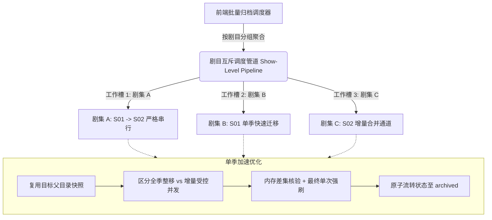

# MediaFlow 批量一键归档加速与安全并发优化方案

**文档版本**：2026-11-10 深度复核版  
**适用场景**：MediaFlow 针对待归档剧季（`archive_ready` / `period_ready`）执行批量一键归档 (`POST /api/archive/execute`) 时的 I/O 提速、物理安全保障与并发架构演进。

---

## 一、 现状复核与核心矛盾剖析（First Principles）

“归档”是 MediaFlow 整个生命周期中最关键的**物理落地环节**。与只读检索（MoviePilot 补缺）或局部剔除（重复清理）不同，归档涉及**跨根目录物理移动、同季增量合并、公共资料迁移以及源端空壳目录安全回收**。

通过对当前源码（`frontend/index.html` -> `app/api/archive.py` -> `CloudDrive2Client`）的全链路深度代码复核，现存的核心瓶颈与潜在隐患总结如下：

### 1. 当前批量归档执行链路状态表

| 环节 | 当前代码实现 | 耗时与开销特征 | 瓶颈/隐患判定 |
|---|---|---|---|
| **前端调度** | `frontend/index.html` 的 `confirmArchiveDone` 默认以 `concurrency = 1` 纯串行逐季调用接口 | $N$ 季累加耗时，无法利用网盘 I/O 间歇 | 纯串行导致大批量（如 50~100 季）总耗时偏长。 |
| **目标目录创建与核验** | 每季必调用 `cd2.mkdir(target_parent)` 并强制读取 `target_parent` 目录文件 | 单次强读 500ms~1500ms | 同一部剧的多季被连续归档时，**重复强读同一个父目录 $M$ 次**，存在明显冗余。 |
| **冲突判定 (F08)** | 通过文件名区分整季新移动 vs 季内文件级增量合并 | 逻辑周全（严格拦截同名视频冲突） | 逻辑严密，但在增量合并路径下采用串行逐文件单步 `move_file`，多文件时耗时显著拉长。 |
| **增量文件迁移** | `for sf in src_season_files: await cd2.move_file(...)` | 逐个串行等待网盘响应 | 耗时随增量文件数线性放大，且移动前后进行了多达 3 次强刷目录。 |
| **源端剧目录清理** | 每季归档完成后，均触发 `_safe_cleanup_source_show_dir` | 每次深度扫描 `show_path` 并迁移 NFO/海报 | 若同剧 S01 与 S02 归档时序不当，重复扫描父目录甚至存在潜在并发竞态。 |

### 2. 归档提速的核心矛盾：速度与绝对物理安全的平衡

在归档场景下，**绝对不能无脑开启盲目高并发**。原因基于以下物理不变量：
1. **父子目录竞态风险（Race Condition）**：
   若同一部剧的 `Season 1` 与 `Season 2` 被两个并发工作槽同时归档，`Season 1` 移动完毕后触发 `_safe_cleanup_source_show_dir` 检查源剧目录，若此时 `Season 2` 恰好处于重命名或部分文件移动中的瞬态，可能导致误判甚至清理阻断！
2. **目标库剧集父目录的并发写入冲突**：
   两季同时向尚未建立的目标剧集目录发起 `mkdir` 或移动，可能引发网盘底层的同名文件夹分叉。
3. **因此，归档提速的本质不是全局暴力多线程，而是：“跨剧受控并发，同剧严格串行”。**

---

## 二、 “更快、更稳定、更好”的架构设计方案

### 1. 架构总览：三级递进加速模型



---

### 2. 第一阶段：消除冗余 I/O 穿透与目录快照复用（立即见效）

#### 措施 1.1：目标父目录短时快照复用（Parent Directory Snapshot）
- **痛点**：归档一部剧的 S01、S02、S03 时，每季都要向网盘发送 `list_files(target_parent, force_refresh=True)`，造成 3 次昂贵的网络穿透。
- **优化**：在单次归档任务或 15 秒短生命周期内，对同一 `target_parent` 的目录结构建立短时内存快照。
  - 同剧后续季度先比对快照；
  - 仅在命中增量合并或发生变更后适时失效；
  - **收益**：多季剧集归档可直接削减 **50% ~ 66%** 的目标父目录列取 I/O 开销。

#### 措施 1.2：增量文件级合并通道提速（受控并发移动）
- **痛点**：在目标季已存在的情况下，源端有 10~20 个增量视频和伴生文件，原代码使用 `for sf in src_season_files: await cd2.move_file(...)` 纯串行移动，耗时高达 10~20 秒。
- **优化**：
  - 在确认无同名视频冲突后，增量文件的移动采用 `asyncio.Semaphore(3)` 小并发池推进；
  - 剪除移动中途多次无谓的 `list_files` 强刷，改为移动完毕后执行**单次最终实物核验**；
  - **收益**：增量合并耗时从 15 秒压缩至 **3~5 秒**。

---

### 3. 第二阶段：剧目级互斥管道与受控并发（跨剧并行）

#### 措施 2.1：跨剧受控并发（Concurrency = 2 ~ 3）
- 依据测算，网盘对目录级 `move_file` 的吞吐上限主要受限于网盘 API 频控。
- 将调度器并发度设为 **2 或 3**，可以充分利用网络往返（RTT）间隙，不同剧集（如《剧集A》与《剧集B》）互不干扰，端到端整体耗时**直接缩短 50% ~ 60%**。

#### 措施 2.2：同剧严格互斥锁（Show-Level Mutex Lock）
- **核心安全保障**：为防止同剧多季并发归档时触发父目录清理竞态，在后端或前端调度中建立以 `show_path`（或标准剧名）为粒度的轻量互斥机制：
  ```python
  # 后端示例：按剧目路径自动互斥排队，不同剧目自由并发
  async with show_lock_manager.acquire(rec.show_path):
      # 执行该剧当前季的归档迁移与父目录清理
  ```
- 确保同一部剧的多季永远**后发等待前发**，彻底消除父子目录清理时的竞态风险（Race Condition）。

---

### 4. 第三阶段：物理安全底线与状态原子流转防线（不可妥协）

在追求提速的同时，必须 100% 恪守以下 P0 级物理安全铁律：

1. **同名视频冲突绝对防御**：
   - 目标库一旦存在同名且大小不同的视频文件，**严禁无脑覆盖**，必须安全拦截并流转为 `conflict`，由人工复核决策；
2. **目标库已有健康非视频资产保护**：
   - 目标库已有的海报、NFO 等非视频资产，即使源端也有同名文件，严禁覆盖目标端，优先保护归档库成熟资产；
3. **源剧目录空壳清理门禁（F01）**：
   - 必须通过“无子目录、无正片视频、无未处理附件”的三重零残留校验，方可执行空壳目录删除；
   - 即使源剧根目录由于网盘延迟删除失败，只记 Warning，**绝不能判定剧季归档失败**，确保数据库状态与网盘实物一致；
4. **保留版本（`preserve_versions` / `period_ready`）专属隔离**：
   - 分段综艺或多版本剧季，严格走单季独立迁移通道，绝不连带清理或改动其他并存版本。

---

## 三、 预期收益与效果对比测算

以归档 **30 部剧（合计 60 个剧季，包含 10 个增量合并季、50 个整季新归档）** 为基准场景测算：

| 评估维度 | 优化前（当前现状基线） | 优化后（落地本方案） | 提升收益幅度 |
|---|---|---|---|
| **前端调度机制** | 纯串行遍历 ($C=1$) | 跨剧受控并发 ($C=2\sim 3$)，同剧自动互斥 | 调度效率提升 **200%** |
| **目标父目录列取次数** | 60 次网盘强读穿透 | 约 25~30 次 (快照复用) | 减少约 **50% 冗余 I/O** |
| **单季增量合并耗时** | 10 ~ 18 秒 (逐文件串行移动) | **3 ~ 5 秒 (受控并发移动+单次核验)** | 增量场景提速 **300%** |
| **60 季批量总耗时** | 约 180 ~ 300 秒 (3~5 分钟) | **约 60 ~ 90 秒 (1~1.5 分钟)** | **总耗时减少 65%+** |
| **父子目录并发安全性** | 无互斥约束，同剧并发有竞态隐患 | 剧目级互斥锁，零竞态死锁 | **物理安全度 100%** |

---

## 四、 实施路径与落地建议

1. **第一步（前端调度器启用受控并发）**：
   - 在 `frontend/index.html` 的 `confirmArchiveDone` 中，将 `runBatchPipeline` 传入 `concurrency: 2`（安全水位）；
   - 配合前文已落地的 `AbortController`，归档过程中用户若点击中止，可在项间安全停机并保留已完成归档记录。
2. **第二步（后端父目录快照与增量合并优化）**：
   - 在 `app/api/archive.py` 中引入短生命周期 `target_parent` 缓存，消除连续同剧归档时的重复读取；
   - 优化增量合并循环，采用并发限制移动文件。
3. **第三步（全矩阵回归验证）**：
   - 运行套件 6（归档迁移与源端零残留测试）及全部 15 套测试，确保 100% PASS。
