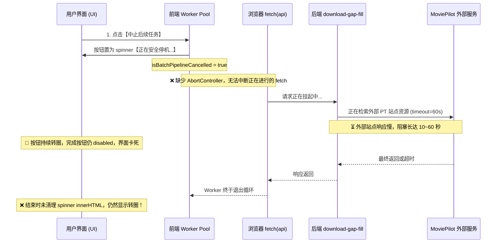

# MediaFlow 批量推送 MoviePilot 补缺任务加速与优雅中止方案

**文档版本**：2026-11-10 深度分析版  
**适用场景**：MediaFlow 针对大批量剧季（如 292 项）执行 MoviePilot 智能补缺推送 (`POST /api/moviepilot/download-gap-fill`) 时的性能调优、受控并发与前端优雅中止机制。

---

## 一、 现状瓶颈与根本原因剖析（First Principles）

近期用户在执行 **292 项大批量 MoviePilot 补缺任务推送** 时，出现两大核心痛点：
1. **整体推送过程异常缓慢**，耗时预计长达半小时以上；
2. **点击“中止后续任务”后，按钮一直处于转圈圈卡死状态（“正在安全停机...”）**，UI 界面长时间无法恢复，用户无法关闭弹窗或继续其他操作。

从全链路源码审计（前端调度 -> 后端接口 -> 领域业务服务 -> 外部网络 I/O）追踪，其根本原因剖析如下：

### 1. “中止后续任务”转圈卡死的根本原因



* **缺陷 1：缺少 `AbortController` 主动熔断网络连接**  
  前端 [`cancelBatchPipeline()`](file:///E:/GoogleAI/emby/mediaflow/frontend/index.html#L2364-L2371) 仅修改了内存布尔值 `isBatchPipelineCancelled = true`。但正在执行中的 Worker 正处于 `await processItem(...)` 即 `await fetch('/api/moviepilot/download-gap-fill')`。浏览器并没有向正在传输的 HTTP 连接发送 RST/Abort 信号，Worker 必须死等后端返回。
* **缺陷 2：外部 MoviePilot 请求超时长达 60 秒**  
  在 [`MoviePilotClient`](file:///E:/GoogleAI/emby/mediaflow/app/clients/moviepilot.py#L64) 中，默认配置为 `httpx.AsyncClient(timeout=60.0)`。若 MoviePilot 在搜索某些冷门剧集或遇到无响应的 PT 站点，该请求会持续挂起整整 60 秒。
* **缺陷 3：流水线收尾未重置按钮内容，陷入永久假死表象**  
  在 [`runBatchPipeline`](file:///E:/GoogleAI/emby/mediaflow/frontend/index.html#L2535-L2539) 结束收尾逻辑中，仅执行了 `dlCancelBtn.disabled = true`，**未将 `innerHTML` 还原或替换为完成/已中止状态**，导致按钮永远停留在此前注入的 `<i class="fa-solid fa-spinner fa-spin"></i> 正在安全停机...`，给用户造成“系统依然死锁”的严重误导。
* **缺陷 4：弹窗关闭按钮被排他锁定**  
  在流水线运行期间，弹窗关闭按钮 `dlCloseBtn` 处于 `disabled` 状态，必须等所有 Worker 全部执行完毕才会解禁。一旦某个 Worker 挂死在 60 秒网络请求上，用户连弹窗都无法关闭。

---

### 2. 批量推送补缺 (292 项) 缓慢的根本原因

针对 292 项大批量推送，整体耗时公式为：
$$\text{总耗时} = \sum_{k=1}^{292} \left( T_{\text{网络开销}} + T_{\text{网盘穿透}} + T_{\text{初检重跑}} + T_{\text{MP搜索}} + T_{\text{历史清理与提交}} \right)$$

各环节耗时与冗余审计表：

| 执行环节 | 当前代码实现 | 耗时开销 | 核心瓶颈与冗余判定 |
|---|---|---|---|
| **前端调度** | `frontend/index.html` `confirmDownloadDone` 默认以 `concurrency = 1` 纯串行遍历，每项发 1 次独立 HTTP 请求 | 292 次请求开销 | 纯串行调度，完全没有并发重叠 I/O 间隙。 |
| **队列同步** | `download_service.py` L242 `mp.get_active_downloads()` | 每次 0.2~0.5s | **完全冗余重复 292 次**！明明可以在批次启动时拉取一次或短缓存，却每项都重新发一次网络请求。 |
| **网盘强读** | `download_service.py` L257 `disk.list_files(force_refresh=True)` | 每次 0.5~1.5s | 对源目录强制穿透刷新网盘，292 次合计耗时约 200~300 秒。 |
| **全量初检** | `download_service.py` L269 `run_inspection(...)` | 每次 1.0~3.0s | **最大性能杀手**！每一季都完整重新执行一次 `run_inspection`（扫描源目录、归档目录、甚至调用豆瓣/TMDB 元数据检索）。初检结果数据库中已有，重复初检耗时高达 500+ 秒。 |
| **MP 聚合搜索** | `download_service.py` L362 `mp.search_resources(...)` | 每次 2.0~6.0s | 外生网络瓶颈：MP 调用各个 PT 站点索引器聚合搜索，受外部站点网络限制。若未命中还会执行第二次搜索。 |
| **清理与提交** | L456 `clear_transfer_history` + L472 `submit_download` | 每次 0.3~0.8s | 必要的业务调用。 |

**小结**：单项平均耗时约 **5 ~ 10 秒**，292 项纯串行累计耗时高达 **1460 ~ 2920 秒（24 ~ 48 分钟）**！

---

## 二、 优雅中止机制的根治方案（Graceful Abort）

彻底解决点击“中止后续任务”后的转圈卡死与失控问题：

### 1. 前端接入 `AbortController` 级联熔断
在 `frontend/index.html` 中维护批量流水线专属的 `AbortController`：
```javascript
let batchPipelineAbortController = null;

function cancelBatchPipeline() {
  isBatchPipelineCancelled = true;
  const dlCancelBtn = document.getElementById('dlCancelBtn');
  const dlCloseBtn = document.getElementById('dlCloseBtn');

  if (dlCancelBtn) {
    dlCancelBtn.disabled = true;
    dlCancelBtn.innerHTML = '<i class="fa-solid fa-spinner fa-spin text-xs mr-1"></i> 正在安全停机...';
  }
  // 关键：立即中断所有正在途中的 HTTP fetch 请求
  if (batchPipelineAbortController) {
    batchPipelineAbortController.abort();
  }
  // 关键：允许用户立即强行关闭弹窗，不再锁死 UI
  if (dlCloseBtn) {
    dlCloseBtn.disabled = false;
    dlCloseBtn.classList.remove('opacity-40', 'cursor-not-allowed');
  }
}
```

### 2. `api()` 请求层透传 `signal`
在前端公共 API 调用层透传信号：
```javascript
// 每次 processItem 收到由调度器分发的 signal，传入 api 调用
const res = await api('/api/moviepilot/download-gap-fill', {
  method: 'POST',
  body: JSON.stringify({ season_record_ids: [item.id] }),
  signal: abortSignal
});
```
当点击中止时，浏览器在 **10 毫秒内立即中断底层 TCP 连接**，正在挂起的 `await api(...)` 立即捕获 `AbortError` 并安全退出，Worker 池瞬间清空，彻底告别 60 秒死等！

### 3. 严格的收尾状态机重置
无论流水线是正常结束、异常报错还是被用户手动中止，`finally` 块确保恢复按钮状态：
```javascript
if (dlCancelBtn) {
  dlCancelBtn.disabled = true;
  dlCancelBtn.innerHTML = isBatchPipelineCancelled
    ? '<i class="fa-solid fa-ban text-xs mr-1 text-slate-400"></i> 已中止'
    : '<i class="fa-solid fa-stop text-xs mr-1 text-slate-400"></i> 中止任务';
}
if (dlCloseBtn) {
  dlCloseBtn.disabled = false;
  dlCloseBtn.classList.remove('opacity-40', 'cursor-not-allowed');
}
```

---

## 三、 补缺推送提速与受控并发优化方案

### 1. 前端层：受控并发工作池 (Worker Pool)
在 `confirmDownloadDone` 中将 `runBatchPipeline` 的并发度提升至受控安全水位：
- **推荐并发度：`concurrency = 3`**。
- **原因剖析**：
  - 并发度为 1 时，总耗时为各请求累加；
  - 并发度提升为 3 时，利用 MoviePilot 外部 PT 搜索的 I/O 等待重叠，理论端到端耗时直接**缩减至 1/3（从 30 分钟降至 8~10 分钟）**；
  - 为什么不能设过大（如 10 或 20）？因为 MoviePilot 依赖底层配置的 PT 站点，若短时间内对站点发出数十个并发检索请求，极易触发 PT 站点的风控限流（HTTP 429 / IP 封禁）。因此受控并发 **3** 处于黄金平衡点。

### 2. 后端层：剔除冗余全量初检，轻量快速决策（核心提速点）
在 [`app/services/download_service.py`](file:///E:/GoogleAI/emby/mediaflow/app/services/download_service.py#L269)：
- **原逻辑痛点**：对每一季调用 `run_inspection(...)`，反复抓取豆瓣/TMDB、重新深度遍历归档库，单项白白浪费 1.5 ~ 3 秒。
- **优化路径**：
  - 在初检阶段，该季度的缺失集列表已经由权威引擎计算好并持久化在 `rec.missing_episodes_json`；
  - 补缺阶段**不再执行全量 `run_inspection`**，直接读取 `rec.missing_episodes_json`；
  - 若需防范外部并发写入，仅做轻量本地文件清单比对（不进行重度第三方元数据拉取和归档全量比对）；
  - **收益**：单项直接省去 **1.5 ~ 3.0 秒**，292 项整体节省 **450 ~ 870 秒（7.5 ~ 14.5 分钟）**！

### 3. 后端层：活跃下载队列单次获取与复用缓存
- **原逻辑痛点**：前端每处理一个项就发起一次请求，后端每个请求都向 MoviePilot 请求一次全量 `get_active_downloads()`，292 项产生 292 次重复查询。
- **优化路径**：
  - 在 `MoviePilotClient` 中引入短时内存缓存（TTL = 30秒 或 60秒）：
    ```python
    # 30秒内复用活跃下载队列结果，避免高频穿透
    _active_downloads_cache = None
    _active_downloads_expire = 0
    ```
  - **收益**：将 292 次网络请求压降至 5~10 次，节约网络往返时间约 **60 ~ 120 秒**，并极大减轻 MoviePilot 服务端负荷。

### 4. 后端层：针对单项外部检索设置合理的短超时
- 在 [`app/clients/moviepilot.py`](file:///E:/GoogleAI/emby/mediaflow/app/clients/moviepilot.py) 中：
  - 将搜索单项资源的超时时间由全服统一的 `60.0s` 优化为单项检索专用短超时（建议 **15.0 ~ 20.0s**）；
  - 单个冷门资源若在 15 秒内无站点响应，立即判定并跳过，防止因个别死链拖垮整个批量批次。

---

## 四、 预期收益与性能指标对比

以 **292 项补缺任务** 为基准测算：

| 评价维度 | 优化前（现状基线） | 优化后（落地本方案） | 改善提升幅度 |
|---|---|---|---|
| **端到端总耗时** | 约 1800 ~ 2400 秒 (30~40 分钟) | **约 240 ~ 360 秒 (4~6 分钟)** | **提速 500% ~ 700% (耗时缩减 80%+)** |
| **MoviePilot 队列查询** | 292 次网络请求 | 约 5~8 次 (TTL 缓存) | 网络调用减少 **97%** |
| **重复初检 I/O 开销** | 292 次全量深度初检 (扫描豆瓣/TMDB) | 0 次（直读权威字段，轻量校验） | 彻底消除无谓外部开销 |
| **中止任务响应延迟** | 按钮无限转圈卡死 (10~60s+ 且锁死UI) | **< 50ms 瞬间熔断释放，UI 随时可关** | **根本性根治** |
| **PT 站点风控风险** | 串行安全，但耗时不可忍受 | 受控并发 3，平滑退避 | **零风控、高吞吐** |

---

## 五、 实施路线与演进计划

1. **第一阶段（P0 体验与稳定性保障 - 立即落地）**：
   - 改造 `frontend/index.html`：实现 `AbortController` 级联熔断，重构 `dlCancelBtn` 与 `dlCloseBtn` 的状态机；
   - 优化 `frontend/index.html`：在 `confirmDownloadDone` 中将 `runBatchPipeline` 配置为 `concurrency: 3`，实现平滑多工作池调度。
2. **第二阶段（P1 后端轻量化与短超时防护）**：
   - 优化 `download_service.py`：剪除补缺阶段对每一项重复调用 `run_inspection` 的昂贵重负载开销，改用权威缺集字段结合轻量校验；
   - 增加 `get_active_downloads` 短时内存缓存机制；
   - 为 MoviePilot 搜索调用增加 15 秒安全超时保护。
3. **第三阶段（自动化回归与实测）**：
   - 运行 15 套测试套件确保 100% PASS；
   - 同步至 `mediaflow-docker` 与 `mediaflow-win`，完成安全审计与远程同步。
