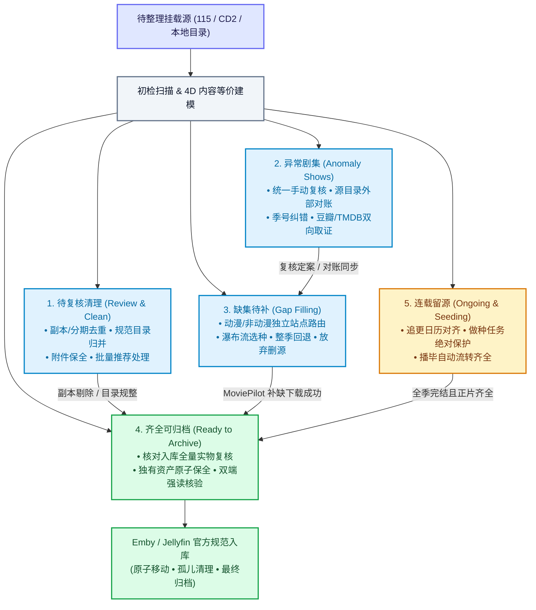

<div align="center">

# 🎬 MediaFlow (media-tools)

**专为 115网盘 · CloudDrive2 · MoviePilot · Emby / Jellyfin 打造的下一代智能化媒体治理与生命周期工作流引擎**

[](VERSIONING.md)
[](https://www.python.org/)
[](#-快速启动与部署)
[](https://github.com/jxxghp/MoviePilot)
[](https://www.clouddrive2.com/)
[](https://opensource.org/licenses/MIT)

<p align="center">
  <a href="#-痛点直击与核心价值">痛点直击</a> •
  <a href="#-系统架构与工作流全景">系统架构</a> •
  <a href="#-五大核心治理模块">五大核心模块</a> •
  <a href="#-两套智能运维助手">运维助手</a> •
  <a href="#-快速启动与部署">快速启动</a> •
  <a href="#-配置指南-env">配置指南</a> •
  <a href="#-零数据丢失安全防线">安全防线</a> •
  <a href="#-技术方案与规范索引">文档索引</a> •
  <a href="#-版本演进与重要里程碑">版本演进 (v2.5.83)</a>
</p>

</div>

---

## 💡 痛点直击与核心价值

在搭建基于 **115网盘 + CloudDrive2 (CD2) + MoviePilot (MP) + Emby/Jellyfin** 的现代家庭影院过程中，影视收藏者和影音玩家普遍面临一系列顽固痛点：

* 💥 **网盘同名碎片与目录撕裂**：115 网盘在 CD2 虚拟挂载下，多次下载极易生成 `(1)` 动态数字后缀；同剧因刮削差异被分裂在多个同名或错名目录下，常规批处理脚本极易误删或引发读写假死。
* 🔍 **刮削口径冲突与误报死锁**：TMDB 与豆瓣元数据冲突、正片与加长版、加更纯享特辑（E00/SP）及多集分段（Part1/Part2）混杂，传统逻辑经常误判“缺集”或“超集”。
* 🔄 **盲目补缺死循环与爆盘**：缺乏精细化做种门禁与站点分类路由，补缺任务盲目拉取超大体积未洗版整包，冲垮网盘配额并引发洗版死循环。
* 🛡️ **误删焦虑与收尾困难**：担心自动化清理误删源端独有的外挂字幕、高清海报、NFO 元数据或珍贵特辑；在网盘外部手动删除文件后，系统产生大量僵尸条目。

**MediaFlow (media-tools)** 采用首创的 **「清理优先」四维内容等价建模**，以**确定性状态机**驱动媒体整理全生命周期，配合严苛的 **G24 物理指纹双向核验**，彻底终结媒体库混乱，实现零数据丢失、高吞吐、可追溯的影视自动化治理。

---

## 🗺️ 系统架构与工作流全景

MediaFlow 确立了清晰的五模块互斥分流与生命周期流水线，所有剧集根据物理文件状态、播出日历与元数据核实结论精准流转：



---

## 🌟 五大核心治理模块

### 1️⃣ 待复核清理 (Review & Clean)
* **四维内容等价模型**：严格区分「普通正片」、「加长版/导演剪辑版」、「Vlog/加更/纯享/E00特辑」与「上下分段 (Part1/Part2)」，同内容组内择优去重，坚决防止不同剪辑版本相互循环覆盖。
* **同 TMDB 多目录规范归并**：自动识别同一作品在网盘中产生的多套碎片目录，支持选择标准目标路径并完成一键原子合并，多季一次性规整。
* **执行推荐处理 (Recommended Execute)**：后端采用受控信号量并发（`Semaphore(10)`）与大批次异步作业轮询，前端配备实时分步进度条，秒级输出处置结论并安全执行。

### 2️⃣ 异常剧集 (Anomaly Shows)
* **统一「手动复核」面板 (v2.5.61 重磅整合)**：将原先分散的重验、改绑、暂不处理收拢为一体化复核工作台，支持集中重核资料与文件、更正季号/总集数、以及可安全恢复的「暂不处理」。
* **五模块源目录对账 (v2.5.61 新增)**：当用户在 CloudDrive2 或 115 外部手动删除了网盘目录时，点击「核对源目录」即可按需发起父目录强读对账，自动核减已消失路径并更新任务统计，彻底告别“已删目录仍卡在列表”的尴尬。
* **双向元数据融合取证**：整合 TMDB 官方元数据与豆瓣多渠道网页/接口搜索，智能处理嵌套详情并保留可读诊断报告，消除外文译名误报。

### 3️⃣ 缺集待补 (Gap Filling)
* **动漫 / 非动漫独立站点规则**：补缺管理中深度隔离动漫（Anime）与常规影视（Non-Anime）两套独立的站点规则。支持双页签独立排序、独立开关，杜绝全站无限制盲目搜索。
* **严谨瀑布流选种决策链**：严格遵循「硬条件门禁 $\to$ 整包/散集阶段 $\to$ 站点优先级 $\to$ 同站做种档位 $\to$ 同档容量 $\to$ 稳定键」决策树，确保优先拉取高分优质种。
* **整季回退与综艺全集识别**：缺集 $\le 3$ 优先补散集；散集资源匮乏时智能回退整季合格包；按期综艺支持总数匹配的 Complete 声明整包识别。
* **无合格资源独立页签**：对于全网无合格种子的作品独立分流归档，支持单季及批量主动放弃删源预览，严格经过执行前指纹复核与幂等回执。

### 4️⃣ 齐全可归档 (Ready to Archive)
* **核对入库全量实物复核 (v2.5.58+)**：下载完成后点击「核对入库」，自动衔接完整物理实物复核，复用初检标准重新计算新副本、新内容版本与归属证据，绝不武断将虚假补齐的季直接归档。
* **独有资产与附件原子保全**：清源前自动将源端独有的加更、特辑、NFO 以及剧根/季级纯附件目录保全至归档库，杜绝误伤外挂字幕与刮削资产。
* **双端强读后验**：目标端入库核验成功且源端目录确认物理消失后，才生成完成回执并标记结案。

### 5️⃣ 连载留源 (Ongoing & Seeding)
* **追更动态追踪**：通过 TMDB + 豆瓣播出日历精确界定“已播缺集”与“未播待映”，未播集目绝不冒充缺集推送下载。
* **做种任务绝对保护**：处于 PT 做种周期或连载活跃期的视频严禁发起删除，安全留源观望，整季播毕齐全后自动流转至归档候选。

---

## 🧰 两套智能运维助手

| 智能助手 | 核心应用场景与核心能力 | 方案设计 |
| :--- | :--- | :--- |
| **🛠️ 媒体整理智能修复**<br/>*(Transfer Auto-Repair)* | 深度解决 MoviePilot 转移整理积压阻挡：<br/>• **基线隔离**：首次启用建立历史游标，不盲目重试几百条存量积压，专注增量捕获。<br/>• **参数智能推导**：清洗 Ver1.1a、压制参数噪音，自动补正类型与季集号，严禁盲套 S01。<br/>• **经验规则复用**：支持按「仅本次 / 记住此下载包 / 记住目录模板」持久化沉淀整理规则。 | [详细方案](MediaFlow媒体整理智能修复需求与交互方案-v2.5.40.md) |
| **📦 电影 / 剧集智能订阅清理**<br/>*(Subscription Clean)* | 宽屏可视化订阅退订与健康度管理：<br/>• **CD2 实盘真相源**：全面以 CloudDrive2 源库与归档库实盘核验为准，彻底消除 0 集误判与旧缓存干扰。<br/>• **双轨独立查询与补缺联动**：剧集与电影独立分开查询，支持断更/老片死种一键补缺（4h 种子缓存 TTL + 失败自动换种）与差异化「仅退订 / 退订+删源」。<br/>• **三重安全护栏**：严格保障院线及流媒体未发售窗口期，收藏白名单与归档成品库绝对保护。 | [电影方案](MediaFlow电影订阅智能清理需求与交互方案-v2.5.72.md)<br/>[剧集方案](MediaFlow剧集订阅智能清理需求与交互方案-v2.5.72.md) |

---

## 🚀 快速启动与部署

MediaFlow 支持 **Windows 原生直接运行** 与 **Docker 容器化部署** 两种方式，满足个人 PC 工作站与 NAS 服务器的不同需求。

### 方式一：Windows 原生免环境运行（推荐 PC / 工作站）

无需安装复杂的 Docker Desktop，直接使用原生 Python 进程运行，与本地 CloudDrive2 挂载盘性能契合度最高：

1. **获取代码并进入目录**：
   ```powershell
   cd media-tools\mediaflow-win
   ```

2. **配置运行环境 (Python 3.11 或 3.12)**：
   ```powershell
   python -m venv .venv
   .\.venv\Scripts\Activate.ps1
   pip install -r requirements.txt
   ```

3. **配置环境变量**：
   ```powershell
   copy .env.example .env
   # 使用记事本或编辑器修改 .env 中的 CD2 / MoviePilot 地址与密钥
   ```

4. **一键启动**：
   * **快捷启动**：双击运行 `启动本地服务.bat`
   * **命令行启动**：
     ```powershell
     python -m uvicorn app.main:app --host 0.0.0.0 --port 8080 --reload
     ```
   打开浏览器访问：`http://localhost:8080` 即可开始使用。

---

### 方式二：Docker 容器化部署（推荐 NAS / Linux 服务器）

针对群晖 Synology、威联通 QNAP、Unraid 或 Linux 服务器环境：

1. **进入 Docker 目录**：
   ```bash
   cd media-tools/mediaflow-docker
   ```

2. **准备配置文件**：
   ```bash
   cp .env.example .env
   vim .env
   ```

3. **编排并启动容器**：
   ```bash
   docker compose up -d --build
   ```

4. **检查容器运行状态**：
   ```bash
   docker compose logs -f
   ```
   服务就绪后，访问 `http://<服务器IP>:8080`。后续升级只需在 `mediaflow-docker` 目录执行 `./upgrade.sh`（自动备份 SQLite 数据库、拉取最新代码、重建容器并验证健康状态）。

---

## ⚙️ 配置指南 (.env)

MediaFlow 所有配置项均以 `MF_` 前缀开头，大小写不敏感：

| 环境变量 | 必填 | 默认值 | 作用与示例说明 |
| :--- | :---: | :---: | :--- |
| `MF_PORT` | 否 | `8080` | Web 界面与 API 服务监听端口 |
| `MF_DEBUG` | 否 | `false` | 是否开启调试模式及详细跟踪日志 |
| `MF_DATA_DIR` | 否 | `./data` | SQLite 数据库、批次快照与执行回执持久化存储目录 |
| `MF_CD2_URL` | **是** | - | CloudDrive2 服务地址，如 `http://localhost:19798` |
| `MF_CD2_TOKEN` | **是** | - | CloudDrive2 认证 Token |
| `MF_MP_URL` | **是** | - | MoviePilot 服务端地址，如 `http://localhost:3001` |
| `MF_MP_TOKEN` | **是** | - | MoviePilot 后台生成的 API Token / Key |
| `MF_SOURCE_ROOT` | **是** | - | 待整理源目录根路径，如 `/115/Library_incs/nas` 或 `Z:\nas` |
| `MF_ARCHIVE_ROOT`| **是** | - | 归档目标根路径，如 `/115/Library_incs/nas.finish` |
| `MF_LIBRARY_ROOT`| 否 | - | Emby / Jellyfin 媒体库扫描路径（通常与归档目标一致） |
| `MF_GAP_FILL_MIN_SEEDERS` | 否 | `2` | 补缺选种最低做种数门禁，低于此数值自动淘汰 |
| `MF_GAP_FILL_EXTRA_SITES` | 否 | - | 补缺扩展优先站点列表（以英文逗号分隔） |

---

## 🛡️ 零数据丢失安全防线

媒体整理最核心的敬畏在于：**宁可暂缓处理，绝不发生误删。** MediaFlow 构建了四层物理级防护锁：

```
┌────────────────────────────────────────────────────────┐
│  第一层：测试与生产强隔离护栏                           │
│  app/database.py 注入运行上下文检测，测试绝不连入生产库   │
├────────────────────────────────────────────────────────┤
│  第二层：CloudDrive2 (1) 后缀与指纹双向校验             │
│  剥离动态序号并校验 (id, size, modified) 防止序号对调误伤 │
├────────────────────────────────────────────────────────┤
│  第三层：纯附件与外层根目录保全事务                      │
│  清源前强制保全 .nfo/海报/外挂字幕，核验到位方可回收源季  │
├────────────────────────────────────────────────────────┤
│  第四层：外部手动删除容错与源目录对账 (v2.5.61)         │
│  强读父目录精确识别物理消失，防范虚假删除，幂等结案      │
└────────────────────────────────────────────────────────┘
```

* **P0 物理防误删探针**：每次执行删除前强制发起实时云盘强读（`force_refresh=True`），只要文件元数据或大小与计划快照不一致，立即中止该项并抛出 `needs_repreview`。
* **隔离测试全矩阵**：工程内包含 167+ 项后端隔离测试套件与 6 份原生前端 DOM/无头脚本，覆盖高并发死锁、断网熔断、幂等回执等全极限场景。

---

## 📚 技术方案与规范索引

仓库内包含完整的需求基线、系统设计演化与专项技术方案，供架构审阅与深度开发者查阅：

| 规范类别 | 文档名称与定位 | 当前最新版本 |
| :--- | :--- | :---: |
| **五模块需求与交互** | [待复核清理模块需求与交互方案](MediaFlow待复核清理模块需求与交互方案-v2.5.61.md)<br/>[异常剧集模块需求与交互方案](MediaFlow异常剧集模块需求与交互方案-v2.5.61.md)<br/>[缺集待补模块需求与交互方案](MediaFlow缺集待补模块需求与交互方案-v2.5.61.md)<br/>[齐全可归档模块需求与交互方案](MediaFlow齐全可归档模块需求与交互方案-v2.5.61.md)<br/>[连载留源模块需求与交互方案](MediaFlow连载留源模块需求与交互方案-v2.5.61.md) | **v2.5.61 ~ v2.5.83** |
| **会话交接与最新进展** | [MediaFlow 会话交接摘要 (v2.5.61)](MediaFlow会话交接摘要-v2.5.61-2026-11-21.md)<br/>[MediaFlow 会话交接摘要 (v2.5.60)](MediaFlow会话交接摘要-v2.5.60-2026-11-20.md)<br/>[MediaFlow 会话交接摘要 (v2.5.59)](MediaFlow会话交接摘要-v2.5.59-2026-11-20.md) | **v2.5.61** |
| **整体重构方案** | [五模块处理流程重构与智能清理方案](MediaFlow五模块处理流程重构与智能清理方案-v2.5.44.md)<br/>[五模块一致性核查报告](MediaFlow五模块一致性核查-v2.5.56-2026-11-20.md) | **v2.5.44 ~ v2.5.56** |
| **专项扩展方案** | [媒体整理智能修复需求与交互方案](MediaFlow媒体整理智能修复需求与交互方案-v2.5.40.md)<br/>[电影订阅智能清理需求与交互方案](MediaFlow电影订阅智能清理需求与交互方案-v2.5.72.md)<br/>[剧集订阅智能清理需求与交互方案](MediaFlow剧集订阅智能清理需求与交互方案-v2.5.72.md) | **v2.5.40 ~ v2.5.72** |
| **历史版本与迁移** | [完整版本演进历史与全量修改记录](VERSIONING.md)<br/>[媒体脚本迁移记录 (油猴版至统一仓库)](MIGRATION.md) | **v1.0 ~ v2.5.83** |

---

## 📈 版本演进与重要里程碑

> 💡 完整版本发布历史详见：👉 **[VERSIONING.md (版本演进全量记录)](VERSIONING.md)**

| 版本号 | 发布日期 | 关键特性与核心演进 | 状态 |
| :---: | :---: | :--- | :---: |
| **`v2.5.83`** | **2026-11-27** | • **多目录全季智能合并、纯空壳旧目录自动回收与「待复核清理」双批量按钮拆分**：修复单条弹窗默认按 S01 扫描导致多季/非 S01 剧旧目录卡死缺陷，新增递归纯空壳/Season 0 特辑/系统垃圾自动安全收尾与 115/CD2 删目录短退避重试及精准残留报错；「待复核清理」拆分为 **「批量处理多目录问题」** 与 **「批量冗余清理」** 两大独立模式与入口 | **最新稳定版** |
| **`v2.5.82`** | **2026-11-25** | • **跨模块选种与媒体身份防线统一收口至 `download_service` 单一底座**：抽离 MoviePilot 下载载荷前置契约（`has_valid_media_info` / `is_valid_download_payload`）及电影/剧集共用站点门槛、精确片名边界、年份校验与 `MediaInfo` 自动回填纯函数；统一剧集与电影关键词回退搜索流水线，同步补齐订阅治理 TV 分支在关键词回退下的同名异片与早期翻拍拦截，并全量对齐多端版本文档 | 历史里程碑 |
| **`v2.5.81`** | **2026-11-25** | • **电影「往年老片死种」批量补缺推送 HTTP 500 与同名异片根治**：关键词回退强制拉取 MP 详情执行「精确 4 位年份 + 严格片名边界」双核验并回填完整 `MediaInfo`；`MoviePilotClient.submit_download` 前置拦空 `media_info` 并透出真实 `detail` 报错；修复实时重搜重试站点规则参数错位（`db, mp, cat_key`）并自愈历史脏缓存 | 历史里程碑 |
| **`v2.5.80`** | **2026-11-25** | • **豆瓣通道体验升级**：支持手动输入影视剧名三通道并发实测，「强制重探状态」并发提速至 ~1.5s，升级 MP 多词探活避免单关键词缓存误判，输出大白话诊断清单与总结结论 | 历史里程碑 |
| **`v2.5.79`** | **2026-11-24** | • **豆瓣多源核验一揽子治理**：引入续季跨年 `±1` 年容差与 `≥2` 年翻拍刚性拦截、候选分层预筛减噪至最低 1 次详情请求、CF 瞬态 1 次自动重试与 404 短路、Worker 并发 `/probe` 与本机 3 步诊断 | 历史里程碑 |
| **`v2.5.78`** | **2026-11-24** | • **初检执行期页面左右抖动像素级根治**：修复奇数 `5px` 滚动条引发居中容器落在 `.5px` 半像素并在合成层升降级时左右跳动的问题（改为偶数 `6px` + `overflow-x: clip` 消除嵌套双滚动容器）；进度条升级为 `will-change: transform` 常驻 `translate3d` 平移，弹窗开启期间冻结背景重绘并按总位数补零锁定计数宽度，Chrome 全缩放比逐帧截图零像素偏移 | 历史里程碑 |
| **`v2.5.77`** | **2026-11-24** | • **豆瓣备选通道升级全文检索双引擎，根治多季/新季漏搜与跨区 Cookie 静默空列表**：CF 反代新增 `/search` 全文检索（Rexxar 全文 + 经典 `j/search` + H5 搜索）且与 Cookie 直连双端接入；CF 公开查询优先干净匿名 `bid` 防国内登录态跨区静默空列表，并修正初检多季搜索过早短路 | 历史里程碑 |
| **`v2.5.76`** | **2026-11-24** | • **豆瓣 CF 反代防 `302/403` 限流缓存治理 + 弹窗即时提示修复**：为 CF 反代加入 `1.1s` 平滑节流、10 分钟 TTL 缓存、`/suggest` 集数元数据兜底与 `302` 自动退避，初检备选搜索改为精简短路并取消无 Cookie 裸连 `403`；豆瓣配置弹窗结果区置顶，「强制重探状态」与「保存并测试连通性」补全加载态与明确连通结论 | 历史里程碑 |
| **`v2.5.75`** | **2026-11-24** | • **初检执行期页面抖动（CLS）彻底治理**：移除实时看板与进度条 `transition-all` 布局动画，全面启用 `contain: layout style paint` 与中英混排固定行高/等宽数字槽位，进度条升级为 GPU 合成层 `transform: scaleX(...)` 零重排渲染，同步消除启动首包延迟与背景重绘抖动 | 历史里程碑 |
| **`v2.5.74`** | **2026-11-24** | • **豆瓣主备自动切换与 Cloudflare 反代 / Cookie-Editor 一键导入**：MoviePilot 豆瓣主通道异常时自动熔断切换至 Cloudflare Workers 反代（`cloudflare-douban-proxy/`）或个人 Cookie 直连，恢复后自动回切；前端顶栏「豆瓣」状态灯新增青色 `豆瓣 (备选)` 态并可点击热配置与三通道实测 | 历史里程碑 |
| **`v2.5.73`** | **2026-11-24** | • **「待复核清理」目录组独立行卡片重构与零重叠去重**：废除嵌套折叠外框，每组待确认归档目标以独立 `app-card` 行卡片平铺展示（行内直出全部关联路径与集数摘要），与下方单季清理列表职责彻底切分并分开计数<br/>• **覆盖矩阵逻辑纠偏**：消除多季目录组笛卡尔积 `0集` 假行与历史季膨胀；归档库未含本季如实标注 `本季未归档` 与 `—` | 历史里程碑 |
| **`v2.5.72`** | **2026-11-24** | • **种子缓存 4 小时 TTL + 失败自动换种**：为可下载种子缓存增加 4h 有效期防 PT 签名直链过期；推送失败自动触发实时重搜并切换其他站点活种重试，同步清理 MP 转移记录；前后端完整透出每部失败作品的站点与报错原因 | 历史里程碑 |
| **`v2.5.71`** | **2026-11-24** | • **CD2 零集纠偏与路径直出**：0 集剧集统一标注灰色 `CD2 未收录`，卡片与弹窗直接展示 `源目录` / `归档库` 路径并支持一键复制、明示仅归档库保护<br/>• **诚实进度条 + 队列防重**：批量动作严格从 `0%` 按真实完成数计进；新增剧集活跃下载队列双重防重并自动清理 MP 本季旧转移记录 | 历史里程碑 |
| **`v2.5.69`** | **2026-11-24** | • **订阅视图高性能交互重构**：主列表与弹窗改用首屏分批 + `IntersectionObserver` 懒追加、`content-visibility: auto` 与 O(1) 分类桶索引，标签切换首帧从 `58~96ms` 降至 `8.7~30.3ms`<br/>• 疑似短剧更名并支持剧集批量「退订+删源」（自动回查 CD2 源季目录，绝对隔离归档成品库） | 历史里程碑 |
| **`v2.5.68`** | 2026-11-23 | • **剧集与电影独立统一查询流水线**：`/subscriptions/query-unified` 支持 `media_type` 精准分流（`tv` / `movie`），CD2 实盘增量合并免全盘重扫，阶段 3 站点搜寻引入 3 并发批次流水线<br/>• **严格 CD2 实盘唯一真相源**：未核验 CD2 严格标记「CD2 未核验」，绝不因 MP 记录误判已完结；目录索引加固防止跨作品误穿透；电影未发售状态严控入库判定<br/>• **彻底删源与剧根空目录自动收尾**：退订并删源彻底清理源视频、字幕、NFO 元数据，无其它季度时深度自动清理剧集外层空目录并刷新 CD2 缓存，即时剔除快照残留<br/>• **复杂前缀与衍生花絮解析防护**：`episode_parser.py` 增强独立花絮/特辑前缀（Clip/Extra/Vlog/Diary/先导片/纯享版/加更版等）识别，14 项专项测试 100% 通过 | 历史里程碑 |
| **`v2.5.66`** | 2026-11-22 | • **「媒体整理智能修复」五层生产级闭环重构 (R01–R33)**：彻底根治 `baseline=0` 误拉 250 条历史与 Windows `os.path.exists` 误杀 Linux 路径缺陷，改为调用 MoviePilot 原生 `POST /api/v1/storage/list` 实时跨机核查源与目标文件、伴随字幕及 `errmsg` 真实报错<br/>• 适配 MP v2.15.6 `ManualTransferItem` 契约，强制 `preview=true` 逐项校验与 `submitted → verifying → 目标落地核验 → resolved` 闭环，挂入后台定时调度循环<br/>• 前端升级为按作品/季或故障根因分组聚合、真实 5 段式证据链详情抽屉、快捷自动修复开关与受控基线重设 | 历史里程碑 |
| **`v2.5.65`** | 2026-11-22 | • **影视剧订阅治理闭环与全流程实时进度**：进入页签秒读本地快照不自动扫描，顶部收敛为唯一主按钮「查询最新订阅数据」（MP ➔ CD2 实盘 ➔ PT 站点三阶段全宽进度面板）<br/>• 剧集/电影各分类精准收口专属功能按钮（全季完结/已入库→批量一键取消订阅；断更/老片死种→批量补缺下载 + 批量取消订阅；零进度/短剧/异常特征→批量取消订阅）<br/>• 所有批量操作接入统一 `400ms` 实时逐项进度条，消除批量退订 $N+1$ 瓶颈 | 历史里程碑 |
| **`v2.5.63`** | **2026-11-22** | • 影视剧订阅治理升级：剧集实存集数与电影入库判定全面改以 CD2 实盘异步快照为准<br/>• 剧集断更拆分为「部分已下·断更」与「零进度死种」，联动补缺选种引擎支持一键批量查源补缺/退订（电影老片死种同步支持）<br/>• 短剧四维识别防误杀长篇国漫与综艺；移除冗余豆瓣标签，新增无封面/繁体/小语种/无中文译名异常特征清理 | 历史里程碑 |
| **`v2.5.62`** | **2026-11-21** | • 缺集待补「核对入库」异步并发化与实时进度条；补缺推送后自动清理 MP 本季转移记录防跳过整理 | 历史里程碑 |
| **`v2.5.61`** | **2026-11-21** | • 异常主卡整合为统一「手动复核」面板（资料重核/文件核验/播期修正/暂不处理）<br/>• 新增五模块「核对源目录」对账机制，彻底兼容网盘外部手动删除场景<br/>• 缺集删源预览前后文件消失容错，通过 167 项后端与 6 份前端自动化测试 | 历史里程碑 |
| **`v2.5.60`** | 2026-11-20 | • 修复清源后剧根「合并保留」目录残留缺陷，纯附件外壳保全后标记完成<br/>• 卡片提供「继续清理剧集外层」，明确真实回执与收尾原因 | 历史里程碑 |
| **`v2.5.59`** | 2026-11-20 | • 统一纯附件目录在识别与清源中的路径逻辑，归档清源前先保全附件再回收源季<br/>• 源季删除强要求明确回执与目录消失核验 | 历史里程碑 |
| **`v2.5.58`** | 2026-11-20 | • 「核对入库」衔接完整物理实物复核，复用初检规则，杜绝新文件误归档<br/>• 实物复核失败时在回执页明确定位并暂停归档与删源 | 历史里程碑 |
| **`v2.5.56`** | 2026-11-20 | • 缺集待补新增「无合格资源」独立页签，支持单季及批量主动放弃删源预览确认<br/>• 前后端版本展示解耦，采用无外部依赖的后端版本动态注入 | 历史里程碑 |
| **`v2.5.50`** | 2026-11-20 | • 补缺站点管理重构：彻底解决动漫/非动漫独立规则刷新回显丢失问题<br/>• 支持双页签脏状态精细追踪与一键协同保存 | 历史里程碑 |
| **`v2.5.49`** | 2026-11-19 | • 攻克 CloudDrive2 针对 115 同名文件动态分配 `(1)` 序号导致的指纹误报<br/>• 落地推荐处理异步作业轮询与实时进度条 | 历史里程碑 |
| **`v2.5.45`** | 2026-11-15 | • **五模块重构重大里程碑**：确立「清理优先」主流程（G01–G28 全场景覆盖）<br/>• 建立统一 4D 内容等价模型与同 TMDB 多目录原子归并引擎 | 架构基线 |

---

## 📂 仓库子项目索引

本仓库 (`media-tools`) 汇集了影音自动化全流程工具集：

```
media-tools/
├── mediaflow-win/          # 【主力推荐】MediaFlow Windows 原生免环境运行版 (FastAPI + Tailwind)
├── mediaflow-docker/       # 【主力推荐】MediaFlow Docker 容器化编排版 (Docker Compose)
├── cloudflare-douban-proxy/# Cloudflare Workers 豆瓣只读元数据反代 (可选备选通道)
├── tv-season-workflow/     # 剧集整理工作流 (Chrome 油猴脚本版，基于 Excel 流转)
├── tv-workflow-win/        # 早期剧集整理 Windows 工具集
├── tv-workflow-Python/     # 早期剧集整理 Python 自动化脚本
├── 剧集整理docker页面设计/    # UI 原型设计与前端视觉规范稿
├── 媒体整理需求/             # 历史基线需求与 MoviePilot 接口接入技术白皮书
├── README.md               # 仓库主说明文档
└── VERSIONING.md           # 完整版本全量变更日志 (v1.0 ~ v2.5.83)
```

---

## 💬 常见问题 (FAQ)

<details>
<summary><b>Q1: 为什么执行批量推荐处理时提示需要重新预览 (needs_repreview)？</b></summary>
这是 MediaFlow 核心安全护栏发挥作用的体现。当后台发现自上次生成计划后，云盘中的文件发生了变动（如新下载了文件、网盘外部进行了移动或重命名），系统将主动拦截当前执行以防止误删。此时只需重新点击预览获取最新快照即可。
</details>

<details>
<summary><b>Q2: 115 网盘同名文件的 (1) 后缀会导致重复下载吗？</b></summary>
不会。MediaFlow 在 v2.5.49 中升级了动态指纹模型，通过文件唯一内部 ID、文件大小与修改时间同簇校验，自动识别 CD2 动态附加的 <code>(1)</code> 后缀，既不会误报幽灵文件，也不会误触发重复下载。
</details>

<details>
<summary><b>Q3: 我已经在网盘网页上手动删除了某个目录，为什么列表中还在？</b></summary>
在 v2.5.61 及以上版本中，针对已在外部手动删除的目录，直接进入对应模块点击卡片上的「核对源目录」按钮，系统会强读云盘父目录对账，确认消失后将直接核减条目并更新统计，不再产生报错。
</details>

---

## 🤝 贡献与许可

欢迎提交 Issue 与 Pull Request 共同改进 MediaFlow！

* **开源协议**：本项目基于 [MIT License](https://opensource.org/licenses/MIT) 开源。
* **致谢**：感谢 [MoviePilot](https://github.com/jxxghp/MoviePilot) 与 [CloudDrive2](https://www.clouddrive2.com/) 社区提供的卓越生态支持。
