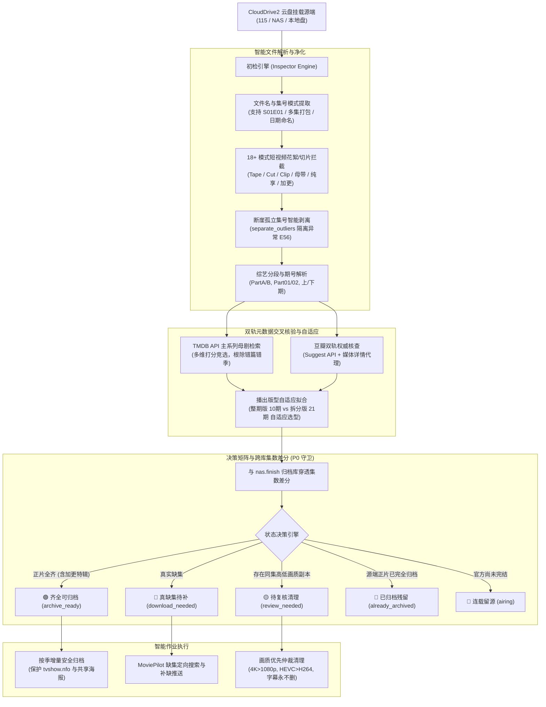

<div align="center">

# 🎬 MediaFlow 媒体流智能治理平台

> **面向家庭影院与云原生 NAS（115网盘 / CloudDrive2 / MoviePilot / Emby / Jellyfin）的新一代智能影视媒体整理、跨库无损归档与双轨运维治理系统。**

[](https://github.com/hailanbb/media-tools/releases)
[](mediaflow-docker/)
[](mediaflow-win/)
[](https://www.python.org/)
[](https://fastapi.tiangolo.com/)
[](LICENSE)

<p align="center">
  <a href="#-平台核心定位与价值">平台定位</a> •
  <a href="#-全链路核心架构与工作流">系统架构</a> •
  <a href="#-快速上手与多平台部署">快速部署</a> •
  <a href="#-六大核心技术特性">核心特性</a> •
  <a href="#-初检诊断决策状态看板">诊断看板</a> •
  <a href="#-绝对零误删物理安全体系">安全守卫</a> •
  <a href="#-版本演进历史-changelog">更新日志</a> •
  <a href="#-技术设计方案文档索引">设计文档</a>
</p>

</div>

---

## 🌟 平台核心定位与价值

在传统的云盘影视库管理中，影视发烧友与家庭 NAS 管理员长期面临四类致命痛点：
1. **元数据撕裂与集数失真**：TMDB 众包数据常将华语综艺拆分为上下集（如 10 期拆成 21 集），而豆瓣与官方流媒体则按整期发布（10 集），导致影视管理软件频报大面积缺集或失真冲突；
2. **花絮切片污染正片**：压制组发布的“短视频切片”、“母带（Tape/Cut）”、“纯享版”等外围短视频，极易被错误识别为正片超高集号（如 S01E37），击溃全剧归档判定；
3. **物理误删与孤本覆灭**：简单的“按目录名匹配”清理极易把含有增量未归档新集的源端文件夹误删，造成不可逆的视频资产损失；
4. **人工运维成本高昂**：海量订阅停滞、卡滞转移队列、跨库集数差异核对等杂务消耗海量精力。

**MediaFlow** 应运而生。它不是简单的文件搬运工具，而是一个集成了 **智能集号/分段解析引擎**、**TMDB & 豆瓣双轨自适应拟合**、**断崖异常集号剥离**、**P0 级跨库集数差分物理安全门禁** 以及 **MoviePilot 运维双轨治理** 的全闭环智能工作台。

---

## 🏗️ 全链路核心架构与工作流

MediaFlow 实现了从源端云盘扫描到最终安全归档入库的全链路自愈流水线：



---

## ⚡ 快速上手与多平台部署

MediaFlow 提供 **Docker 容器化** 与 **Windows 原生免环境运行** 两种部署形态，底层业务逻辑与单元测试 100% 保持一致。

### 🐳 方案 A：Docker 容器一键部署（推荐 NAS / Linux 服务器）

进入 [`mediaflow-docker/`](mediaflow-docker/) 目录：

```bash
# 1. 克隆代码仓库
git clone https://github.com/hailanbb/media-tools.git
cd media-tools/mediaflow-docker

# 2. 配置环境变量
cp .env.example .env
# 编辑 .env 文件，填入 CloudDrive2 与 MoviePilot 连接凭据
vim .env

# 3. 一键启动容器
docker compose up -d

# 4. 浏览器访问工作台
# http://<服务器IP>:8080
```

### 🪟 方案 B：Windows 原生便携运行（推荐 PC / 本地主机）

进入 [`mediaflow-win/`](mediaflow-win/) 目录：

```powershell
# 1. 进入目录并配置环境变量
cd media-tools/mediaflow-win
copy .env.example .env
# 使用记事本或 VS Code 填入 .env 密钥配置

# 2. 安装依赖并启动
pip install -r requirements.txt
python -m uvicorn app.main:app --host 0.0.0.0 --port 8080
```

> [!TIP]
> 详细跨端环境与代码同步指引，可参阅 [版本管理与跨端同步说明 (VERSIONING.md)](mediaflow-win/VERSIONING.md)。

---

## 🎯 六大核心技术特性

### 1. 综艺分段与复杂命名智能解析 (`segments.py` & `episode_parser.py`)
- **多段正片原生覆盖**：全面解析 `PartA/PartB`、`Part01/Part02`、`上/下期`、`上/中/下` 等复杂分段，按实际播出期数建立精确覆盖映射，杜绝上下集综艺误报缺集；
- **全方位花絮切片拦截**：深度拦截 `Cut`、`Clip`、`Tape`、`母带`、`切片`、`看点`、`片段`、`纯享版`、`加更版` 等 18+ 模式衍生短视频，纯净提炼正片序列；
- **作品标题遮蔽保护**：智能区分作品原名中的关键词（如《Hot Ones: Extra Heat》），避免剧名本身包含“Extra”或“纯享”时被误杀为花絮。

### 2. TMDB & 豆瓣双轨自适应拟合 (`inspector.py`)
- **彻底打破单源垄断**：华语剧集/综艺初检时，主动并行拉取 TMDB 与豆瓣双源元数据；
- **双重播出版型自适应选型**：
  - 本地为 **整期版（~10集）**：自动拟合豆瓣 10 期权威口径，主动排除 TMDB 21 集上下拆分版干扰；
  - 本地为 **拆分版（~21集）**：自动适配 TMDB 拆分编号；
- **正片全齐附带特辑直接就绪**：官方正片已齐前提下，连续 1~3 集收官特辑/加更篇自动容纳，直接归为 `archive_ready`。

### 3. 断崖孤立异常集号智能剥离 (`separate_outliers`)
- 当识别集号序列中出现断崖式跳空且无后续文件（如正片 1..12 集后突兀出现单个 143MB 的孤立 E56），算法自动将其剥离为外围衍生集；
- 避免因压制组命名随意导致的虚假大面积缺集误报（如误报“缺失 13..21 集”）。

### 4. 绝对物理安全与 P0 防误删门禁体系
- **P0-1 冗余残留清理安全防御体系**：源端季目录必须为受控源根目录的严格子目录；源端未识别到有效正片集号时（如空壳残渣目录），强制拦截并转人工确认，严禁自动清理；
- **跨库深入文件集数级比对**：穿透归档目标库，断言源端集数全部被归档库包含才允许清理；源端含有增量新集时，强力保护留源；
- **字幕与重要资产终身免死**：清理仅处理明确确认的视频冗余，外挂字幕（`.srt`/`.ass`）和公共资产（`tvshow.nfo`、剧集海报）永久保留。

### 5. MoviePilot 智能补缺与订阅治理双轨分离
- **真缺集精准推送**：根据源端与归档库联合缺集清单，精准向 MoviePilot 发送缺失集号补齐指令；
- **分段综艺与普通剧集差异化处理**：普通剧集标题包含 `Part 1/2` 时，不阻断其他正片缺集检索；
- **两阶段订阅清理与资源核查**：全面核查站点资源与做种情况，提供“仅退订”与“退订并清理源视频”两种清晰操作。

### 6. 响应式现代化极简前端交互 (`index.html`)
- 基于 Tailwind CSS 3 构建，完美支持**浅色/暗黑模式自适应切换**；
- 引入 `localStorage` 任务状态持久化记忆，刷新页面无缝锚定当前任务，消灭首屏闪现跳变；
- 全站 XSS 防御，所有文件路径、剧集标题均通过安全 DOM 节点转义输出。

---

## 📋 初检诊断决策状态看板

系统根据文件覆盖与元数据状态，将所有扫描季自动分流至 5 大心智决策专区：

| 决策看板卡片 | 状态标识 (`status`) | 触发条件与系统行为 | 推荐操作 |
|:---|:---:|:---|:---|
| **齐备可归档** | 🟢 `archive_ready` | 官方正片全齐无缺集、无未处理重复版本，或跨库汇聚后已全集齐备 | **一键归档**（增量转移至目标库） |
| **真缺集待补** | 🔴 `download_needed` | 官方已完结但本地确有缺集，按真实缺号排列 | **补缺/整理**（推送到 MP 检索下载） |
| **异常剧集** | ⚠️ `split_conflict` / `unknown` | 官方未收录、拆分严重不一致或需人工标记 | **核对/手动处理**（确认后可持久隐藏） |
| **待复核清理** | 🟡 `review_needed` | 本地存在同集多画质版本、或源端残留空壳需人工确认 | **去重/纠偏处置**（画质优选安全清理） |
| **连载留源** | 🔵 `airing` | 官方尚未完结且正片正常连载中 | **追更留源**（保留在源目录等待更新） |

---

## 🛡️ 绝对零误删物理安全体系

```text
================================================================================
                    MediaFlow 物理数据安全底线规则 (P0-P2)
================================================================================
[P0-1 门禁] 源端路径越界阻断  ->  源目录必须为 MF_SOURCE_ROOT 严格子目录，根路径禁删
[P0-2 门禁] 空壳空集误删熔断  ->  源端识别正片集数为 0 时，绝对禁止误判为已归档残留
[P0-3 门禁] 跨库增量保护防线  ->  源端包含归档库未收录集数时，绝对禁止整剧/整季删除
[P1-1 守卫] 外挂字幕绝对保护  ->  .srt / .ass / .sub 等独有字幕全流程免死，自动迁移
[P1-2 守卫] 媒体资产留源机制  ->  tvshow.nfo / poster.jpg / fanart.jpg 严禁作为冗余清除
[P2-1 仲裁] 画质优先去重算法  ->  4K > 1080p > 720p，HEVC/AV1 > H.264，保留最优版本
================================================================================
```

---

## 📦 核心配置环境变量清单

在 `.env` 中按需配置：

| 环境变量参数 | 必填 | 默认值 | 详细功能说明 |
|:---|:---:|:---:|:---|
| `MF_CD2_URL` | ✅ | `http://localhost:19798` | CloudDrive2 gRPC-Web 服务地址 |
| `MF_CD2_TOKEN` | ✅ | - | CloudDrive2 API 认证令牌 (JWT Token) |
| `MF_MP_URL` | ✅ | `http://localhost:3001` | MoviePilot 服务地址 |
| `MF_MP_TOKEN` | ✅ | - | MoviePilot API Key (`X-API-KEY`) |
| `MF_SOURCE_ROOT` | ✅ | `/115/Library_incs/nas` | 待整理影视源目录根路径 |
| `MF_ARCHIVE_ROOT` | ✅ | `/115/Library_incs/nas.finish` | 规范影视归档库根路径 |
| `MF_LIBRARY_ROOT` | 否 | 同 `MF_ARCHIVE_ROOT` | Emby / Jellyfin 媒体库扫描路径 |
| `MF_PORT` | 否 | `8080` | Web 界面与 HTTP API 服务监听端口 |
| `MF_AUTH_TOKEN` | 否 | - | Web 访问鉴权 Token（留空则不开启访问限制） |
| `MF_DEBUG` | 否 | `false` | 是否开启详细调试日志模式 |

---

## 📚 技术设计方案文档索引

MediaFlow 的每一项核心机制均遵循严谨的第一性原理设计方案。您可在仓库中直接阅读完整的工程规范文档：

* 📘 [《MediaFlow剧季元数据交叉核对与纠错方案》](MediaFlow剧季元数据交叉核对与纠错方案.md) —— 双轨主动核对、播出版型自适应与断崖剥离的核心理论模型；
* 📗 [《MediaFlow批量一键归档加速与安全并发方案》](MediaFlow批量一键归档加速与安全并发方案-2026-11-10.md) —— 归档完成判断修正、无损同名跳过、剧级互斥锁与快照复用规范；
* 📙 [《MediaFlow批量冗余清理加速与受控并发方案》](MediaFlow批量冗余清理加速与受控并发方案-2026-11-10.md) —— 单次实物重读双向核验、主视频优先从属删除与受控工作池；
* 📕 [《MediaFlow批量推送MoviePilot补缺加速与优雅中止方案》](MediaFlow批量推送MoviePilot补缺加速与优雅中止方案-2026-11-10.md) —— 瞬时 AbortController 熔断、批次隔离与短时 TTL 队列快照；
* 📒 [《MediaFlow批量补缺选种、站点与整季回退优化方案》](MediaFlow批量补缺选种、站点与整季回退优化方案-2026-11-12.md) —— 做种同档内省容量优先、动态六站扩展（含天空/观众）、整季安全回退与已有集保护。

---

## 📜 版本演进历史 (Changelog)

### 🚀 最新稳定版：v2.5.16 (2026-11-12)

* **批量补缺选种省容量、站点扩展与整季安全回退优化**：
  * **同做种档内省容量优先**：以本轮最高做种数 $H$ 划分同档边界 $H - \text{seeders} \le \max(1, \lfloor H \times 10\% \rfloor)$，同档内严格按实际需下载总字节升序选种；大小 `0` 或为空视作未知排在已知之后；支持跨站同种去重（保留多站来源）；多集拼包通过 Pareto 剪枝与有界搜索优先最大化覆盖并比总字节（连集包容量仅计一次），日志详列次选体积差；
  * **动态将“天空”“观众”纳入补缺默认搜索**：每次按实例实时读取 MP 默认站点 `IndexerSites` 与站点状态（禁止写死 ID），仅合并已启用有效站并统一传递至 TMDB 精确搜索、标题回退与整季补搜；MP 默认为空代表全站时保留全范围不缩窄，配置读取失败不缩窄且明确标明范围未确认；
  * **散集不全时安全回退整季包并保护已有集**：合格散集能补齐时优先散集；存在未覆盖缺号且同季队列无文件重叠时，优先凭文件清单、完整分集表或显式全集声明严格核验 `1..total_episodes`（拒收仅标 `S03`、缺段综艺或部分已播集），然后触发最多一次原名/别名整季补搜与单次提交；提交前仅清理真实缺号的明确冲突整理记录，绝不传 `episodes=None` 清空全季历史，提交超时先查 MP 下载队列防重。

#### v2.5.15 (2026-11-11)

* **批量一键归档加速、完成判断修正与安全并发体系**：
  * **增量合并完成条件修正（P0）**：显式区分“读取成功且为空”与“读取失败”。当末次读取源季失败时，记为待核实，保存已处理文件并安全保留源季，坚决杜绝误标已归档或误删源目录；
  * **杜绝盲目删除非视频伴生资产（P0）**：同名字幕、NFO、海报可能内容不同，默认两端保留并列出冲突，未知附件严格留源；
  * **归档写入统一启用跳过同名策略（P0）**：整季移动、单文件增量移动及公共资产迁移统一使用 `skip_existing=True`，杜绝任何同名覆盖；
  * **目标多候选安全熔断（P0）**：目标库匹配到多个候选季目录时安全停止，展示候选路径转入人工核实；
  * **路径规范化红线（P0）**：写入前严格规范化源、目标及父路径，拒绝相同或互相包含的路径，严密保护平铺单季；
  * **剧级后端互斥与父目录快照复用（P1）**：引入剧目级规范化路径互斥锁，同剧多季串行化并复用父目录与季名列表快照，剧根空壳检查合并在该剧全部所选季完成后安全执行一次；
  * **前端多状态对账反馈**：细化呈现“已归档”、“部分归档”、“结果待核实”与“归档完成、源端仍有附件”，支持优雅中止并即时安全对账。

#### v2.5.14 (2026-11-10)

* **批量冗余清理加速与双向物理实物核验**：
  * 剪除连续两次强刷网盘的冗余 I/O，改为单次实物重读核验保留版本与消除版本，杜绝幽灵文件假成功；
  * 确立“主视频优先、伴生文件严格从属”的安全删除顺序，主视频删除失败严格保留单集 NFO 与海报，外挂字幕 100% 免死保护；
  * 前端批量冗余清理升级为受控 Worker Pool 调度（`concurrency = 2`），平滑消除串行等待；
* **MoviePilot 补缺任务加速与优雅中止机制**：
  * 前端接入 `AbortController` 级联瞬时网络熔断，中止时 10ms 内释放挂起请求，彻底根治转圈伪死锁并立即解禁关闭按钮；
  * 分配独立 `batchId` 与 Session 隔离控制器，杜绝跨批次回调与日志污染；
  * 规范数学不变量结算（成功 + 暂缓 + 取消 + 失败 === 总数，单季多种子按 1 季成功结算）；
  * 后端引入活跃下载队列 30s TTL 共享快照，并建立本地已受理待确认清单（`_recently_submitted_tasks`），彻底杜绝并发推送时的重复提交。

#### v2.5.13 (2026-11-10)
* **精准按实际缺号推送补缺**：
  * 普通剧集文件名含 `Part 1/2` 等非分段标记者，不再阻断后续正片缺集检索，确保已编号资源可正常匹配；
  * 批量补缺清晰区分“已提交”、“暂无资源”、“队列已有”与“接口失败”，部分匹配时直观展示剩余待补集数；
* **跨目录剧季统一识别与豆瓣深度核对 (v2.5.12)**：
  * 直接选取独立季目录初检时，自动定位上级剧目身份，各目录统一核对豆瓣记录，英文短季亦能发现口径差异并保留未来播出计划；
* **综艺分段精准分流与别名清理 (v2.5.11)**：
  * 综艺按整期、分段和作品身份精准分流；同一作品别名归档已齐时，支持独立清理本季源端并做二次覆盖校验。

<details>
<summary><b>👉 点击展开查看历史版本日志 (v2.5.0 ~ v2.5.10)</b></summary>

<br>

#### v2.5.10 (2026-11-10)
* 撤销独立“文件核对”模块，待人工研判项统一并入“异常剧集”，支持单条一键“已手动处理”并持久隐藏；
* 归档正片已齐且源端仅剩 NFO/图片等附件的空壳记录，在新初检中自动标记已完成；
* 缩短分段诊断报告文案，避免口径核验误读为严重缺集。

#### v2.5.9 (2026-11-10)
* 新增综艺分段原生覆盖核对，全面保护 `PartA/B` 与 `Part01/02`；
* 订阅管理引入资源检索核查，支持按确认清单退订并联合清理源视频，提供未完成中断恢复机制。

#### v2.5.8 (2026-11-10)
* 增强归档核对与豆瓣季度资料核查，精细化提示同集具体重复副本；
* 提供异常条目持久隐藏入口，支持缺集清单直接删除源端整部剧目录。

#### v2.5.7 (2026-11-09)
* 落实元数据交叉核验方案：华语作品初检强制主动双轨核验豆瓣，打破 TMDB 单源垄断；
* 实现双重播出版型自适应拟合（拆分版 21 集 vs 整期版 10 集按本地实际文件排布自适应决定）；
* 拦截 `Cut`、`Clip`、`Tape`、`母带` 等 18+ 模式花絮切片；
* 引入 `separate_outliers` 算法自动剥离断崖孤立花絮（如 E56）；
* 正片全齐附带 1~3 集连续收官特辑直接就绪为 `archive_ready`。

#### v2.5.6 (2026-11-09)
* 引入 TMDB 候选多维打分竞选算法（首播年份匹配 +40 分、纯标题纯净度 +30 分），彻底根除因同名衍生剧导致的“贪婪首中错误”；
* 建立溢出集数自动自愈校准机制，遇超范围集号自动升轨拟合或拉取豆瓣权威数据纠偏。

#### v2.5.5 (2026-11-09)
* 彻底攻克 P0-1、P0-2、P0-3 三大物理数据安全死穴，建立终道数学约束，保障 100% 绝对零误删；
* 完整通过《MediaFlow通用Agent测试用例与执行手册》全部 83 项用例与 8 大核心离线安全探针；
* 前端全站 XSS 转义防御，实现 `localStorage` 任务状态记忆持久化。

</details>

---

<div align="center">
  <sub>MediaFlow · 赋能家庭影院与云原生影视自动化治理 · 遵循 MIT 开源协议</sub>
</div>
