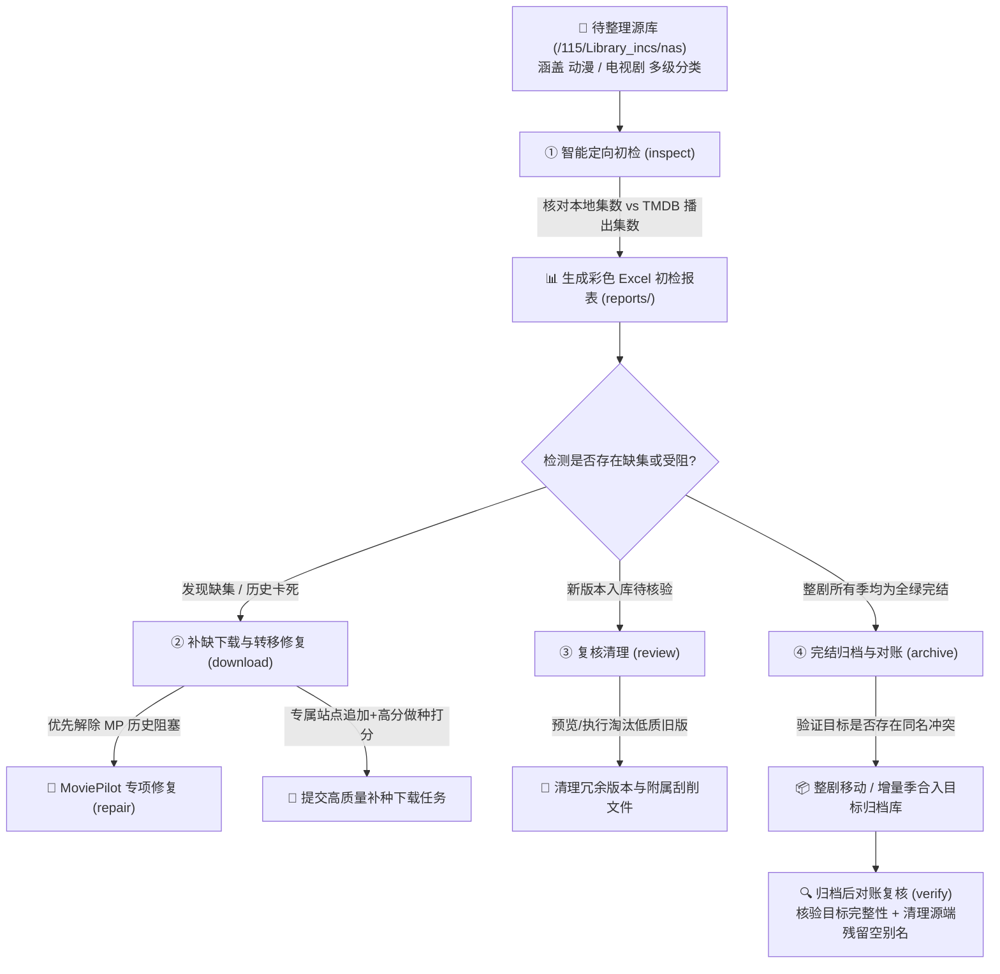

# 🎬 Media Tools 剧集与动漫全生命周期智能整理工作流

> 基于 **CloudDrive2 + MoviePilot + TMDB** 的无头媒体自动化整理后端，支持 **Windows 桌面/后台版** 与 **Ubuntu/Linux 服务器版** 双端交付。

[](https://nodejs.org/)
[](https://www.python.org/)
[](https://www.clouddrive2.com/)
[](https://github.com/jxxghp/MoviePilot)
[](https://www.themoviedb.org/)
[]()

---

## 📌 项目背景与解决的核心痛点

在基于 **NAS / 115网盘 + CloudDrive2 + MoviePilot + Emby/Plex/Jellyfin** 搭建的现代私有媒体库体系中，影视资源的收集与整理常常面临以下深层困境：

### 1. 缺集漏下难排查，人工核对成本高昂
连载剧集与动漫在多站点自动抓取过程中，极易出现由于做种缺失、网络抖动或分集规则不一致导致的**断更、跳集、缺集**。人工翻找几百部剧集的文件列表排查缺漏耗时费力，极度缺乏一种能够自动化与 TMDB 官方权威播出日历核对各季集数的手段。

### 2. MoviePilot 整理历史阻塞卡死
MoviePilot 在下载完成后进行自动化识别转移时，若遇到识别置信度不足、目录重名或目标路径冲突，会在转移历史中留下“失败/待人工处理”的阻塞条目。若不及时解除该状态，后续重新下载的正确集数或后续剧集将会**无限期被阻断在下载盘**，无法入库。

### 3. 多版本冗余与网盘空间恶性膨胀
当补缺下载或压制组更新了高码率、内封简繁字幕的高清版本后，网盘中原本残留的尝鲜版、外挂字幕等旧版本文件未被及时清理，导致网盘存储空间被无效消耗，且 Emby/Plex 端会出现同集多个版本的显示混乱。

### 4. 完结归档易发生破坏性覆盖与残留污染
当一部剧集全部播毕并确认全季完整后，通常需要将其从“整理过渡库”移动到“正式完结归档库”。传统手动剪切容易引发三大灾难：
- **同名剧集大小写冲突**（Linux与网盘底层对大小写敏感）；
- **增量季覆盖风险**（若目标库已存在第 1 季，直接覆盖目录会导致历史季丢失）；
- **源目录空别名残留**（源目录留下仅剩同名空壳文件夹，诱发下一次定时刮削混乱）。

### 5. 动漫（Anime）整理与传统电视剧的巨大形态差异
传统的电视剧整理逻辑直接套用在动漫上往往会全面失效：
- **特典文件污染**：动漫压制组常常附带 `NCOP`（无字片头）、`NCED`（无字片尾）、`PV`（宣传PV）、`CM`（商广广告）、`Preview`（下集预告）、`Menu`（光盘菜单）等，极易被粗糙的正则表达式误识别为主线正片第 1 集；
- **非标命名多样**：日文原版 `第xx話`、字幕组方括号编号 `[01]` / `[01v2]`、中间横杠 ` - 01` 等格式繁杂；
- **MoviePilot 接口陷阱**：在 MoviePilot 中通过 TMDB ID 搜索动漫时，若请求类型传 `动漫` 会直接触发后端 500 内部错误，必须严格传入 `电视剧` 进行检索，而在入库与转移记录匹配时又必须同时兼容 `动漫` 与 `电视剧` 两种类型。

---

## 🏗️ 核心流程闭环架构

本项目通过严密的状态机与数据契约，将媒体整理固化为四大标准执行阶段：



### 📊 Excel 报表五色诊断体系

| 标识色 | 判定状态 | 业务含义与流转逻辑 |
| :---: | :---: | :--- |
| 🟩 **绿色** | **完结无缺集** | 本地文件集数完全匹配 TMDB 官方总集数。整剧**所有季均呈绿色**时，具备安全归档资格。 |
| 🟦 **蓝色** | **连载更新中** | 本地集数等于 TMDB 当前已播出的最新集数，但全季尚未播完。正常保持监听，暂缓归档。 |
| 🟨 **黄色** | **疑似缺集** | 本地集数少于已播出集数，或中间出现断茬跳集。自动作为任务流转至**阶段二（补缺下载）**。 |
| 🟥 **红色** | **异常待查** | 资源未检索到有效做种、TMDB 暂无本季详细分集数据或文件名集号无法解析，需人工复核。 |
| ⬜ **无底色**| **特殊/待定** | 暂未刮削、单文件目录或仅有特典文件的非正片条目。 |

---

## 🗂️ 仓库目录布局与双端版本选型

本仓库提供两种完全对等业务能力的实现版本，您可以根据自己的部署环境自由选用：

```text
media-tools/
├── tv-workflow-win/        # 💻 Windows 桌面/后台版 (Node.js ESM 实现)
├── tv-workflow-Python/     # 🐧 Ubuntu / Linux 服务器版 (纯原生 Python 3 实现)
├── 媒体整理需求/            # 📚 完整技术设计文档、数据契约与接口研究资料 (15篇深度文档)
└── README.md               # 📖 仓库总览指南
```

### 双端版本选型对照表

| 维度 | tv-workflow-win (Windows 版) | tv-workflow-Python (Linux 版) |
| :--- | :--- | :--- |
| **推荐运行环境** | Windows 10 / 11 个人电脑或工作站 | Ubuntu 20.04 / 22.04 / 24.04 LTS、Debian、各类 NAS 服务器 |
| **底层开发语言** | Node.js (ES Modules 原生) | Python 3 (原生无复杂 C 扩展) |
| **环境搭建门槛** | 安装 Node.js LTS 即可运行 | **极低**：自带 `install.sh` 脚本，免配虚拟环境，一键搞定依赖 |
| **交互控制台** | 内置终端交互菜单 (`node bin/tray.js`) | 内置终端交互菜单 (`tv`)，完全适配 UTF-8 ANSI 终端 |
| **后台守护常驻** | 内置基于 node-cron 的调度器与控制台挂机 | 支持标准的 Linux **systemd** 系统守护进程，开机静默自启 |
| **桌面系统通知** | Windows 11 原生 Toast 气泡弹窗通知 | Linux 终端安全日志输出与灵活扩展通知 |
| **适合的用户** | 习惯在 Windows 本地管理网盘、查看报表的用户 | 7×24 小时开机的 NAS、软路由或 VPS 云服务器用户 |

---

## 🛠️ 傻瓜式安装与使用引导

无论您是 Windows 用户还是 Linux 服务器用户，均只需几分钟即可完成部署：

---

### 💻 路线一：Windows 用户傻瓜指南 (`tv-workflow-win`)

#### 第 1 步：安装 Node.js 环境
1. 前往 [Node.js 官方下载页](https://nodejs.org/)，下载并安装 **LTS 版本**（建议 Node.js 18 或 20+）；
2. 保持默认选项一路点击“下一步（Next）”直至安装完成；
3. 打开 PowerShell，输入 `node -v` 能够看到版本号即表示环境准备就绪。

#### 第 2 步：下载项目与安装依赖
1. 下载或克隆本项目到本地，进入 Windows 版目录：
   ```powershell
   cd tv-workflow-win
   ```
2. 执行依赖安装命令：
   ```powershell
   npm install
   ```

#### 第 3 步：配置连接信息
1. 复制配置文件模板：
   ```powershell
   copy config.example.json config.json
   ```
2. 用记事本打开 `config.json`，填写以下核心项：
   - `clouddrive2.origin`: CloudDrive2 访问地址（例如 `http://127.0.0.1:19798`）
   - `clouddrive2.token`: CloudDrive2 API 令牌
   - `moviepilot.origin`: MoviePilot 访问地址（例如 `http://127.0.0.1:3000`）
   - `moviepilot.token`: MoviePilot 个人中心 API 令牌
   - `moviepilot.extraSearchSites`: 补缺下载追加的专属站点（默认已配置 `["观众", "天空"]`）
   - `tmdb.apiKey`: TMDB API Key（免费申请，用于核对准确集数）
   - `paths.source`: 整理源根目录（默认 `/115/Library_incs/nas`）
   - `paths.destination`: 归档目标根目录（默认 `/115/Library_incs/nas.finish`）

#### 第 4 步：启动使用
直接双击或在终端输入以下命令启动交互控制台：
```powershell
node bin/tray.js
```
终端将弹出数字菜单，直接输入 `1` 即可体验按媒体库（动漫/电视剧）$\to$ 分类 $\to$ 剧集的多级分选初检！

---

### 🐧 路线二：Linux / Ubuntu 服务器用户傻瓜指南 (`tv-workflow-Python`)

#### 第 1 步：上传项目目录并配置
1. 将 `tv-workflow-Python` 文件夹上传到 Ubuntu 服务器的任意路径（如 `/opt/tv-workflow-Python` 或 `~/tv-workflow-Python`）；
2. 进入目录并生成配置文件：
   ```bash
   cd /opt/tv-workflow-Python
   cp config.example.json config.json
   nano config.json   # 填入 CloudDrive2、MoviePilot 与 TMDB 的实际地址与令牌
   ```

#### 第 2 步：一键初始化环境（免配虚拟环境）
执行项目自带的一键初始化脚本：
```bash
sudo chmod +x install.sh
sudo bash install.sh
```
> **脚本会自动执行**：
> - 检测并安装系统级 `python3`、`pip3` 与基础工具；
> - 自动安装 `openpyxl`、`requests`、`croniter` 等必备 Python 库；
> - 为所有可执行脚本赋予 Linux 执行权限；
> - **注册系统全局快捷指令 `tv` 到 `/usr/local/bin/tv`**。

#### 第 3 步：全局极简运行
在服务器的**任意路径**下，直接输入 `tv` 即可进入控制台：
```bash
tv
```
呈现如下操作菜单：
```text
══════════════════════════════════════════════════
  🎬 剧集整理工作流 (Python 版) — 后台运行中
══════════════════════════════════════════════════
  定时配置: [0 2 * * *] (每日自动执行)

  [1] 选剧/分类初检（浏览选择媒体库、分类与剧集，支持多选）
  [2] 立即补缺下载（含自动整理修复）
  [r] MoviePilot 整理历史专项修复
  [3] 立即复核清理（预览模式）
  [4] 立即执行归档（预览模式）
  [5] 复核清理（执行删除）
  [6] 执行归档（实际移动并自动对账复核）
  [v] 归档后对账复核（验证目标完整性与清理残留空别名）
  [7] 全自动流程 (初检→下载→复核→归档)
  [8] 查看最新报表路径
  [9] 查看最新运行日志
  [0] 退出
══════════════════════════════════════════════════
```

#### 第 4 步：开机静默自启（可选）
如果希望服务器每日凌晨 02:00 自动执行全流程，配置 systemd 服务即可：
```bash
sudo cp systemd/tv-workflow.service /etc/systemd/system/
sudo systemctl daemon-reload
sudo systemctl enable --now tv-workflow.service

# 查看服务状态与日志
sudo systemctl status tv-workflow.service
sudo journalctl -u tv-workflow.service -f
```

---

## ⚡ 命令行高频指令速查表

在终端环境下，您可以直接执行特定指令快速完成任务（Windows 下为 `node bin/tv-workflow.js <命令>`，Linux 下直接用 `tv <命令>`）：

| 操作场景 | Windows 命令 | Ubuntu/Linux 命令 | 功能说明 |
| :--- | :--- | :--- | :--- |
| **交互式选剧初检** | `node bin/tv-workflow.js inspect -i` | `tv inspect -i` | 分级浏览 动漫/电视剧 $\to$ 子分类 $\to$ 剧集多选初检 |
| **指定子分类初检** | `node bin/tv-workflow.js inspect --category 日韩动漫` | `tv inspect --category 日韩动漫` | 仅初检指定分类（如 日韩动漫、国产剧） |
| **剧名关键字初检** | `node bin/tv-workflow.js inspect --show 凡人修仙传` | `tv inspect --show 凡人修仙传` | 快速初检匹配剧名的全部目录 |
| **精确路径初检** | `node bin/tv-workflow.js inspect --path "/115/.../葬送的芙莉莲"` | `tv inspect --path "/115/.../葬送的芙莉莲"` | 精确初检网盘任意指定剧集目录 |
| **补缺下载与修复** | `node bin/tv-workflow.js download` | `tv download` | 读取最新报表，优先修复 MoviePilot 阻塞历史并补种 |
| **整理历史专项修复** | `node bin/tv-workflow.js repair` | `tv repair` | 仅检查并解除 MoviePilot 阻塞历史并重转 |
| **复核清理 (预览)** | `node bin/tv-workflow.js review` | `tv review` | 预核算待淘汰删除的低质冗余旧版本与刮削残留 |
| **复核清理 (执行)** | `node bin/tv-workflow.js review --yes` | `tv review --yes` | 实际删除冗余文件并自动刷新网盘季目录缓存 |
| **完结归档 (预览)** | `node bin/tv-workflow.js archive` | `tv archive` | 预核算全绿完结剧集，检查目标冲突 |
| **完结归档 (执行)** | `node bin/tv-workflow.js archive --yes` | `tv archive --yes` | 执行归档移动，并自动触发目标完整性核验与存量对账 |
| **独立归档核验** | `node bin/tv-workflow.js verify` | `tv verify` | 核对目标文件、源存量，并自动安全清理残留的空别名目录 |
| **全自动执行全流程** | `node bin/tv-workflow.js auto` | `tv auto` | 自动依次执行 初检 $\to$ 下载修复 $\to$ 清理 $\to$ 归档对账 |

---

## 📚 详细设计规范与二次开发资料

仓库中的 `媒体整理需求/` 目录完整收录了经过实际生产环境验证的 15 篇详细规格说明书，适合二次开发与架构推演参考：

- 📑 [01-核心需求基线.md](媒体整理需求/01-核心需求基线.md) — 77 条核心业务规则基线
- 📑 [02-剧集初检详细需求.md](媒体整理需求/02-剧集初检详细需求.md) — 目录自适应识别与集数核验
- 📑 [03-补缺下载详细需求.md](媒体整理需求/03-补缺下载详细需求.md) — 资源搜索打分与做种数优选算法
- 📑 [04-复核清理详细需求.md](媒体整理需求/04-复核清理详细需求.md) — 冗余版本识别与刮削文件安全清理
- 📑 [05-剧集归档详细需求.md](媒体整理需求/05-剧集归档详细需求.md) — 增量季合入与归档对账规范
- 📑 [06-技术方案与数据契约.md](媒体整理需求/06-技术方案与数据契约.md) — Excel 报表结构与状态机字段定义
- 📑 [10-MoviePilot接口研究与接入方案.md](媒体整理需求/10-MoviePilot接口研究与接入方案.md) — MoviePilot v2 REST API 实测与避坑要点
- 📑 [11-动漫整理专项需求与命名规范.md](媒体整理需求/11-动漫整理专项需求与命名规范.md) — 动漫特典过滤与压制组命名深度规则
- 📑 [08-验收用例与追踪.md](媒体整理需求/08-验收用例与追踪.md) — 87 个真实场景验证集

---

## 🔒 安全与隐私声明

1. **绝对凭据隔离**：本项目严格遵循凭据安全规约，`.gitignore` 已全局忽略真实配置文件 `config.json`、运行日志 `logs/` 与业务报表 `reports/`，保证您的网盘令牌与 API Key 绝不外泄。
2. **非破坏性操作设计**：所有涉及文件删除（复核清理）与文件移动（归档）的操作，默认均为**只读预览模式（Dry-Run）**，只有显式附加 `--yes` 或在交互菜单中输入明确确认项时才会实际变更网盘文件。
3. **闭环对账机制**：归档完成后自动执行目标目录完整性验证与源目录存量对账，确保文件安全落地，杜绝移动过程中数据丢失。

---

## 📄 开源许可

本项目基于 MIT 许可证开源，欢迎提交 Issue 与 Pull Request 共同优化媒体整理工作流体验！
