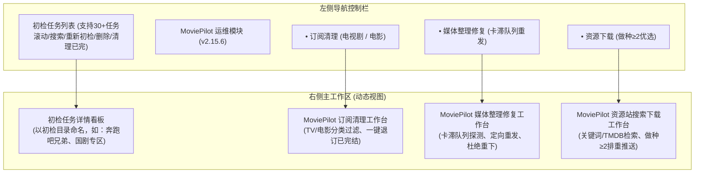

# 剧集整理 Docker 页面设计 (MediaFlow)

**项目名称**：MediaFlow - 智能媒体库整理与归档工作台  
**适用环境**：Ubuntu 22.04 LTS / Docker 容器化运行（支持公网反向代理安全访问）  
**业务基线**：GitHub `media-tools/媒体整理需求` 1.3 版本（2026-10-27）  
**设计目标**：美观、简洁、易懂、便捷操作、零多余选项；全流程智能诊断，一键修改，最大程度减少用户手工维护修改、重命名、移动与删除。

---

## 一、 系统架构与导航信息流

整体系统界面遵循现代 SaaS 产品的极简美学，分为 **左侧控制面板（初检任务库 + MoviePilot运维模块）** 与 **右侧主工作区（任务结果看板 / 运维工作台）**：

---

## 二、 核心页面设计与关键交互亮点

### 1. 视觉风格与双主题系统
* **浅色主题（默认）**：采用纯净雅致的 Slate-50 底色与纯白卡片，冷灰微边框搭配淡雅状态胶囊，视觉通透自然；
* **暗黑主题（一键切换）**：顶部常驻 `☀️ / 🌙` 切换按钮，支持在浅色与科技感暗黑主题（`#0b0f19`）间丝滑切换，配置自动持久化保存。

### 2. 初检任务菜单（轻松应对 30+ 任务）
* **以初检目录名称命名任务**：例如单剧任务以《奔跑吧！兄弟 (2014)》命名，分类任务以《国剧经典专区》命名；
* **轻量搜索框**：侧边栏顶部常驻搜索条，支持按目录路径或剧名实时检索过滤；
* **限高独立滚动**：任务容器限高（`max-h-[340px]`），滚动顺滑，支持大批量任务并存；
* **单项与批量生命周期操作**：
  * 每个任务卡片在鼠标悬浮时提供 **【🔄 重新初检】** 与 **【🗑️ 删除任务】** 快捷操作；
  * 列表顶部提供 **【清理已完】** 按钮，一键批量清除已全季归档的旧记录，保持侧边栏清爽；
  * 任务右侧标有健康状态指示点（🟢 全绿可归档 / 🟡 需去重复核 / 🔵 需补缺下载）。

### 3. 点击式目录选择器（免除键盘手动输入）
* **纯点击式目录树浏览器（Folder Browser）**：
  * 点击“新建初检任务”，弹窗呈现可视化目录树；
  * 点击任意文件夹即可深入展开下级，顶部自带面包屑导航与“返回上一级”按钮；
  * 支持直接点击“选定此项”或“选定当前整级目录”，彻底告别手工敲打路径的易错烦恼；
* **清晰分辨不同存储源的常用快捷目录**：
  * 预设标签直接标明底层源盘与归档盘的前缀差异：
    * `[未整理源] nas / 电视剧 / 国产剧` (`/115/Library_incs/nas/电视剧/国产剧/`)
    * `[已归档库] nas.finish / 电视剧 / 国产剧` (`/115/Library_incs/nas.finish/电视剧/国产剧/`)
    * `[未整理源] nas / 电视剧 / 综艺`
    * `[未整理源] nas / 动漫 / 2024秋`
* **无多余冗余选项**：彻底剔除“对账政策”等复杂技术配置项，后台默认以 TMDB 为主，超出时经 MoviePilot 调用豆瓣复核。

### 4. 任务初检结果看板：四大分类钻取与严格隔离的操作按钮
点击任务后，右侧呈现四大分类汇总卡，点击分类卡下方列表即时联动，且**各分类下的批量与单项操作按钮严格隔离，绝不混淆**：

| 结果分类卡片 | 呈现的内容清单 | 顶部专属批量按钮 (动态切换) | 清单行内专属单项处置按钮 | 专属对账预检弹窗 |
| :--- | :--- | :--- | :--- | :--- |
| **🟢 齐全可归档** | 内容完整、已播完且核验通过的季清单 | **【批量一键归档所选 (N 季)】** *(仅在该分类下显示)* | **【单项一键归档】** | **归档预检框**：展示目标迁移路径、留源保护资料（`tvshow.nfo` 原件安全保留）。 |
| **🟡 待复核清理** | 发现同集重复副本、多版本混杂、错季散落、超出TMDB范围等需处置项 | **【批量一键清理所选冗余 (N 处)】** | • **【一键清理冗余 E10】**（去重且释放空间） • **【一键采纳豆瓣数据】**（本地超出TMDB时重算为18集） • **【一键错季归位】**（将散落的S02文件移回S02） • **【一键规范绑定】**（日韩目录别名映射） | **复核清理框**：精准列出待删冗余视频文件名与释放空间；**严密标注外挂字幕 (`.srt/.ass`) 与海报 100% 保护不删**。 |
| **🔵 真缺集待补** | 排除待播与在途后的真实已播缺集，以及 MP 转移队列卡滞文件 | **【批量一键推送 MP 补缺 (N 季)】** | • **【一键整理修复 (重发MP)】**（针对下载器已有但MP转移卡滞的文件，**直接触发转移重试，杜绝重新下载**） • **【一键优选补缺】**（做种数≥2、中文优先推送下载） | **补缺/修复框**：展示即将推送到 MoviePilot 的下载或修复任务，带防重下排重锁。 |
| **⚪ 连载留源** | 正在播映更新中的剧集季清单 | **【批量保持连载留源 (N 季)】** | **【持续留源追更】** | 明确标记留源追踪，待全季完结播齐后自动流转至【齐全可归档】。 |

### 5. 左侧栏 MoviePilot 专属运维模块
在任务列表正下方，追加与 MoviePilot v2.15.6 深度集成的专属模块，点击即可在右侧切换到对应的专属运维视图：
1. **订阅清理（剧集 / 电影）**：
   * 自动识别已全部播齐入库或已归档的订阅项目；
   * 提供电视剧、电影分类过滤，支持 **【一键清理已完结订阅】**，释放 MoviePilot 定时轮询的服务器负载；
2. **媒体整理修复**：
   * 直连 `/api/v1/transfer/queue`，实时探测下载器中已完成、但因历史转移锁或文件冲突卡滞的项目（如《迷宫饭》E12）；
   * 提供 **【一键整理修复】**，直接重发转移，**绝不重复下载**；
3. **资源下载**：
   * 提供影视与种子检索，严格按**“做种数≥2、官译中字、容量成本最优”**进行排序与筛选；
   * 支持一键推送下载并加上排重锁。

---

## 三、 原型文件清单与使用方式

本目录下包含以下页面设计资产：
* [`ui_prototype.html`](ui_prototype.html) / [`index.html`](index.html)：高保真、纯前端、可交互的完整单文件页面原型（包含全部 Tailwind CSS 样式与 JavaScript 交互逻辑）。

### 浏览器预览方式
无需配置任何构建工具或环境依赖，直接使用浏览器双击打开 `index.html` 或 `ui_prototype.html` 即可直接体验：
1. 右上角点击 `☀️ / 🌙` 测试浅色/暗黑主题切换；
2. 试用左侧任务搜索框过滤任务、悬浮卡片点击重检/删除任务；
3. 点击顶部 **【新建初检任务】**，体验全点击式的目录树逐级穿透与 `nas` vs `nas.finish` 的区分；
4. 点击左侧栏的 **【订阅清理】**、**【媒体整理修复】**、**【资源下载】**，体验 MoviePilot 各模块的专属视图；
5. 点击不同任务与四类结果分类卡片，查看专属批量操作按钮与单项一键处置弹窗。
